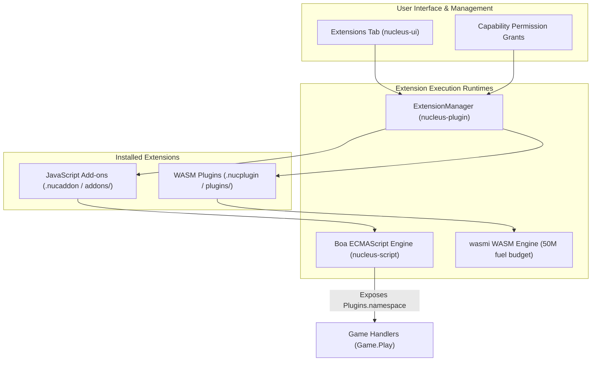
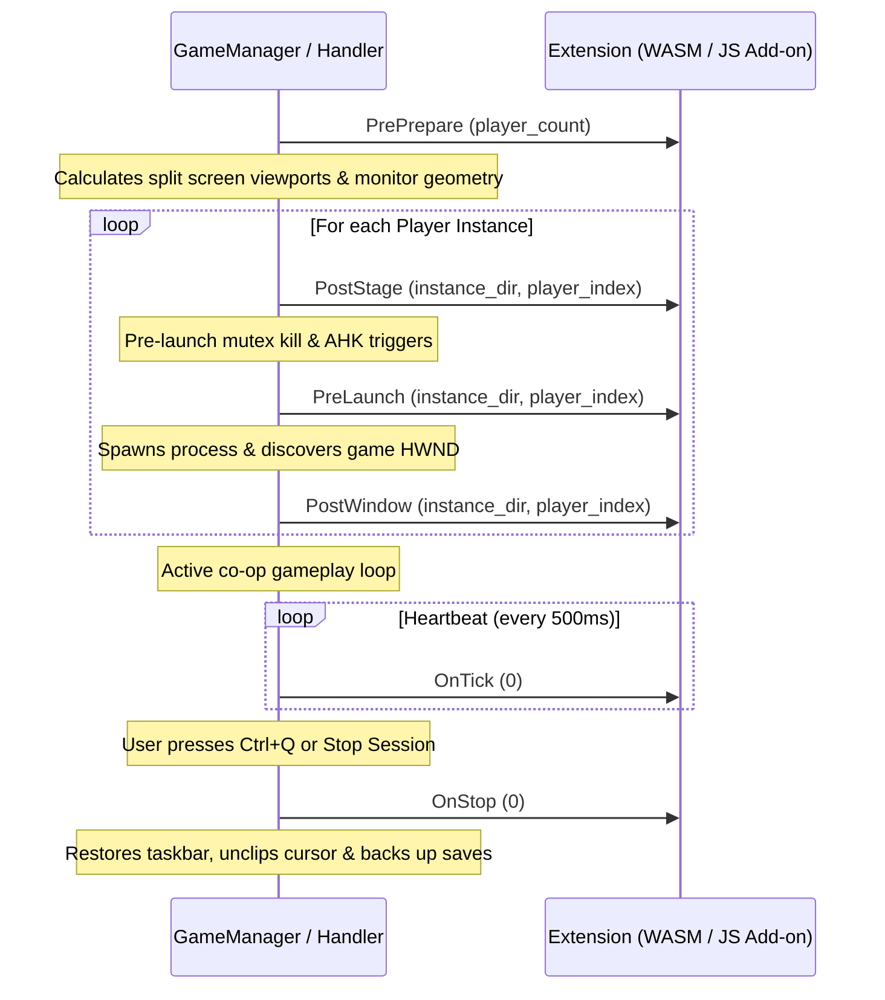

# Rusteus-Coop Extension & Add-on Developer Guide

> **Authoritative Specification & Reference Manual for Building, Packaging, and Distributing Extensions for Rusteus-Coop (Nucleus Co-op Rust Rewrite)**

---

## 1. Introduction & Architecture

Rusteus-Coop features a modern, modular extension architecture that allows developers to extend the splitscreen engine, automate complex setups, enhance game compatibility, and introduce custom tools without modifying the core codebase.

The extension ecosystem is designed around three key pillars:

1. **Security & Sandboxing**: Extensions run in constrained environments with explicit capability-based permissions. Sandboxed WebAssembly plugins are gas-metered with strict instruction fuel budgets (50M fuel/hook), preventing runaway execution or UI thread freezes.
2. **Zero-Friction Script Integration**: JavaScript add-ons expose functions directly to SplitscreenMe `.js` game handlers under the global `Plugins.<namespace>` property, running on the embedded pure-Rust Boa ECMAScript engine.
3. **Packaging Simplicity**: Extensions can be distributed as loose folders or compressed single-file packages with `.nucaddon` (for JavaScript add-ons) or `.nucplugin` (for WebAssembly modules) extensions.



---

## 2. Extension Classifications

Rusteus-Coop supports four classifications of extensions declared via the `kind` field in the manifest:

| Kind | Package Extension | Installation Root | Execution Runtime | Best Used For |
|---|---|---|---|---|
| `js-addon` | `.nucaddon` / folder | `addons/` | `boa_engine` (ECMAScript) | Custom handler helpers, FOV/aspect ratio calculators, session loggers, save game sanitizers, custom UI options. |
| `wasm` | `.nucplugin` / folder | `plugins/` | `wasmi` (WebAssembly) | High-performance binary logic, cryptographic utilities, binary format parsers, custom memory injectors. |
| `theme-pack` | `.nucaddon` / folder | `addons/` | GPUI Kit Asset Manager | Custom UI color themes, icons, background artwork, font styling. |
| `dotnet-legacy` | folder | `plugins/` | Legacy Bridge | Backward compatibility with legacy C# NucleusCoop plugins (`pluginsInfo.txt`). |

---

## 3. The Manifest Specification (`plugin.toml`)

Every extension must include either a `plugin.toml` or `addon.toml` file at its root.

### Annotated Reference Manifest

```toml
# ==============================================================================
# Extension Manifest
# ==============================================================================

# Unique reverse-DNS identifier (Mandatory)
# Format: <domain-reversed>.<author-or-org>.<extension-name>
id = "org.splitscreenme.session-companion"

# JavaScript identifier exposed in handlers under `Plugins.<js_namespace>` (Mandatory)
# Must be a valid ECMAScript identifier: starts with [A-Za-z_], contains [A-Za-z0-9_]
js_namespace = "sessionCompanion"

# Human-readable title displayed in the UI (Mandatory)
name = "Session Companion & Diagnostics"

# Semantic Version (SemVer 2.0.0) (Mandatory)
version = "1.0.0"

# Author or maintaining organization (Recommended)
author = "Rusteus-Coop Community"

# Brief description of functionality (Recommended)
description = "Exemplary splitscreen session telemetry, viewport aspect ratio & FOV optimizer, and diagnostic report generator."

# Minimum compatible Rusteus-Coop engine version (Optional)
min_nucleus_version = "0.2.0"

# Extension runtime category: "js-addon", "wasm", "theme-pack", "dotnet-legacy" (Mandatory)
kind = "js-addon"

# Relative path to primary entrypoint file (Mandatory)
# For js-addon: e.g. "index.js" or "src/main.js"
# For wasm: e.g. "bin/plugin.wasm"
entrypoint = "index.js"

# Explicit capability permissions required by this extension (Optional)
permissions = [
    "instance_fs_read",
    "instance_fs_write",
    "lifecycle_hooks",
    "script_api_export"
]

# Multi-instance lifecycle hooks subscribed to by this extension (Optional)
hooks = [
    "pre_prepare",
    "post_stage",
    "pre_launch",
    "post_window",
    "on_stop"
]

# Dependencies on other extensions with SemVer requirements (Optional)
[dependencies]
# "com.example.core-math" = "^1.2.0"
```

---

## 4. Capability Permissions Matrix

Rusteus-Coop enforces a capability-based security model. Extensions declare what system resources they require. Users can inspect and grant permissions in the **Extensions & Add-ons** UI pane.

| Permission Identifier | Display Title | Description | Security Risk |
|---|---|---|---|
| `instance_fs_read` | Read Instance Files | Read access to files inside the assigned instance directory (`./content/<Game>/Instance<N>`). | Low |
| `instance_fs_write` | Modify Instance Files | Write and modify configuration or save files in the instance directory. | Low |
| `environment_fs` | Access Player Environment | Read and write access inside `%USERPROFILE%\NucleusCoop\<PlayerNickname>`. | Medium |
| `registry_ops` | Modify Windows Registry | Read, write, or export keys in Windows Registry. | Medium |
| `process_spawn_scoped`| Spawn Process Tools | Launch whitelisted auxiliary binaries or utility tools. | Medium |
| `window_control` | Control Game Windows | Enforce window bounds, positioning, or borderless styles. | Low |
| `script_api_export` | Export Script APIs | Expose JavaScript methods to game handlers under `Plugins.<namespace>`. | Low |
| `lifecycle_hooks` | Hook Lifecycle Events | Receive callbacks during instance staging, launching, and teardown. | Low |
| `network_outbound` | Outbound Network Requests | Make HTTP requests to external APIs or services. | Medium |
| `unrestricted_native` | Unrestricted Native Access | Direct native DLL execution (only for legacy C# binaries). | High |

---

## 5. Multi-Instance Lifecycle Hooks

Extensions subscribing to `hooks` receive lifecycle event triggers:



### Hook Definitions

- **`pre_prepare`**: Fired before any instance staging begins. Argument: total player count.
- **`post_stage`**: Fired after an instance directory has been populated with symlinks/hardlinks. Argument: player index. Directory: instance path.
- **`pre_launch`**: Fired immediately before child process creation.
- **`post_window`**: Fired after the viewport HWND is located and borderless window bounds are applied.
- **`on_tick`**: Fired during the background 500ms heartbeat loop.
- **`on_stop`**: Fired during session shutdown and cleanup.

---

## 6. Developing JavaScript Add-ons

JavaScript add-ons are evaluated inside the embedded pure-Rust Boa ECMAScript runtime.

### The Add-on Execution Wrapper
When loaded, Rusteus-Coop wraps your `entrypoint` in an isolated closure:

```javascript
/* Nucleus Addon: {name} v{version} */
(function() {
  var __addon_ns = '{js_namespace}';
  if (!globalThis.Plugins) globalThis.Plugins = {};
  var exports = {};
  globalThis.Plugins[__addon_ns] = exports;
  (function(exports, Plugins) {
      // YOUR CODE RUNS HERE
  })(exports, globalThis.Plugins);
})();
```

### Writing Exports
Attach any functions or objects to `exports`. They will immediately become accessible to handlers:

```javascript
// index.js

exports.version = "1.0.0";

/**
 * Calculates corrected Field of View for non-standard aspect ratios.
 */
exports.calculateFov = function(baseHorizontalFov, width, height) {
    var baseH = baseHorizontalFov || 90;
    var w = Math.max(1, width || 1920);
    var h = Math.max(1, height || 1080);
    var currentAspect = w / h;
    var standardAspect = 16.0 / 9.0;

    var baseHRad = (baseH * Math.PI) / 180.0;
    var verticalFovRad = 2.0 * Math.atan(Math.tan(baseHRad / 2.0) / standardAspect);
    var adjustedHRad = 2.0 * Math.atan(Math.tan(verticalFovRad / 2.0) * currentAspect);
    var recommendedFov = Math.round((adjustedHRad * 180.0) / Math.PI);

    return Math.max(45, Math.min(135, recommendedFov));
};
```

### Accessing Your Add-on from a Game Handler
In SplitscreenMe `.js` game handlers, call your extension using `Plugins.<js_namespace>`:

```javascript
// handler.js
Game.Play = function() {
    if (typeof Plugins !== "undefined" && Plugins.sessionCompanion) {
        var optimalFov = Plugins.sessionCompanion.calculateFov(90, Context.Width, Context.Height);
        Context.CustomArguments += " -fov " + optimalFov;
    }
};
```

---

## 7. Reference Example: Session Companion & Diagnostics

The repository includes a complete, production-ready example add-on located at:
`nucleus-coop/addons/org.splitscreenme.session-companion/`

### Features Implemented:
1. **Aspect Ratio Normalization**: Accurately computes simplified aspect fractions (`16:9`, `8:9`, `32:9`).
2. **Horizontal-to-Vertical FOV Compensation**: Solves vertical splitscreen camera compression.
3. **Session Telemetry**: Records lifecycle events, timestamps, and geometry allocations.
4. **HTML Diagnostic Dashboard**: Generates an interactive dark-themed report (`session_diagnostic_report.html`) complete with layout schematics, player matrices, and health checks.

---

## 8. Packaging & Distribution

### Packaging into a `.nucaddon` or `.nucplugin`

An extension package is a standard ZIP archive containing your `plugin.toml` and entrypoint files at the root of the archive:

#### Using PowerShell:
```powershell
# 1. Compress folder contents into a temporary zip file
Compress-Archive -Path "org.splitscreenme.session-companion\*" -DestinationPath "session-companion.zip"

# 2. Rename to .nucaddon (or .nucplugin for WASM)
Move-Item -Path "session-companion.zip" -Destination "org.splitscreenme.session-companion.nucaddon"
```

#### Archive Safety Verification
When Rusteus-Coop unpacks an archive:
- It computes the **SHA-256** binary digest for audit logging.
- It enforces strict **Zip-Slip protection**, rejecting archives containing directory traversal (`..`) or absolute paths.

---

## 9. Installation & Deployment

Extensions can be installed using any of the following methods:

### Method A: Graphical User Interface
1. Launch Rusteus-Coop.
2. Navigate to the **Extensions & Add-ons** tab in the main sidebar.
3. Click the **Install Extension** button.
4. Select your `.nucaddon` or `.nucplugin` file.
5. The extension will be unpacked and verified immediately.

### Method B: Folder Drop (Manual Installation)
Drop the unpacked folder into either of the following locations:
- **User Installation**: `%APPDATA%\Nucleus Coop\addons\<extension-id>\`
- **Portable / Workspace Installation**: `<InstallRoot>\addons\<extension-id>\`

Click **Rescan** in the Extensions tab to activate newly dropped folders.

---

## 10. Best Practices & Coding Standards

1. **Keep ECMAScript Standard**: Avoid browser-only APIs (`window`, `document`, `fetch`). Stick to standard JavaScript supported by the Boa engine.
2. **Safe Identifier Names**: Always use a clean alphanumeric `js_namespace` (e.g. `saveFixer`, `sessionStats`).
3. **Handle Undefined Safely**: In handlers, always guard extension calls with:
   ```javascript
   if (typeof Plugins !== "undefined" && Plugins.myExtension) {
       Plugins.myExtension.doSomething();
   }
   ```
4. **SemVer Discipline**: Follow semantic versioning (`major.minor.patch`). Increment `major` if changing function signatures.
