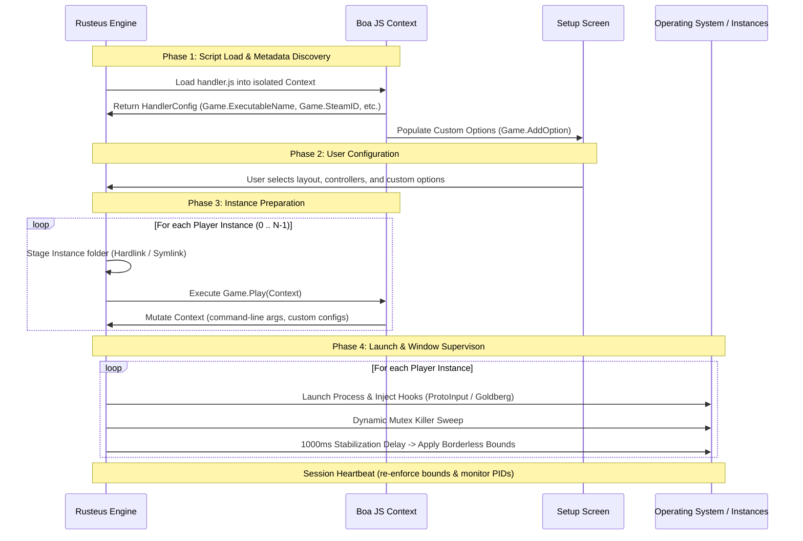

# SplitscreenMe Handler Developer Guide & JavaScript API Specification

Welcome to the definitive guide for authoring game handlers for **Rusteus-Coop** and SplitscreenMe. A handler is a JavaScript (`.js`) file that instructs the engine on how to stage, launch, hook, partition, and isolate multiple instances of a game.

Rusteus-Coop provides **100% backward compatibility** with legacy SplitscreenMe handlers while exposing powerful modern capabilities (AutoHotkey scripting, Ludusavi savegame isolation, WASM plugins, and live OSD Drop-In).

---

## 1. Handler Lifecycle & Execution Architecture

A game handler undergoes four distinct execution phases during a session:



---

## 2. Global JavaScript API Reference

### 2.1 The `Game` Object (Configuration)

The global `Game` object defines static handler properties.

#### Identification & Basic Settings
| Property | Type | Default | Description |
|---|---|---|---|
| `Game.GUID` | `string` | `""` | Unique identifier for the handler. |
| `Game.GameName` | `string` | `""` | Display name of the game in the UI. |
| `Game.SteamID` | `string` | `""` | Steam App ID (used for Goldberg emulator and cover art). |
| `Game.MaxPlayers` | `number` | `4` | Maximum players supported across all displays. |
| `Game.MaxPlayersOneMonitor` | `number` | `4` | Maximum players supported on a single physical display. |
| `Game.ExecutableName` | `string` | `""` | Primary executable name (e.g. `"left4dead2.exe"`). |
| `Game.ExecutableNames` | `string[]` | `[]` | Alternative executable names to recognize. |
| `Game.BinariesFolder` | `string` | `""` | Subfolder where binary files reside relative to root (e.g. `"bin/win64"`). |
| `Game.WorkingFolder` | `string` | `""` | Working directory for the process if different from binary directory. |
| `Game.LauncherExe` | `string` | `""` | Separate launcher executable if the game launches via a secondary binary. |
| `Game.LauncherTitle` | `string` | `""` | Window title of the launcher to detect. |
| `Game.PauseBetweenStarts` | `number` | `1000` | Delay in milliseconds between launching consecutive instances. |

#### Filesystem Staging & Sandbox
| Property | Type | Default | Description |
|---|---|---|---|
| `Game.SymlinkGame` | `boolean` | `true` | Symlink/hardlink game files into instance folders. |
| `Game.SymlinkFolders` | `boolean` | `false` | Create directory junctions (`mklink /J`) for top-level directories. |
| `Game.HardcopyGame` | `boolean` | `false` | Force a complete physical file copy of all game files (slow!). |
| `Game.HardlinkGame` | `boolean` | `false` | Explicitly request NTFS hardlinks. *(Note: Rusteus automatically falls back to hardlinks if symlinks fail!)* |
| `Game.DirSymlinkExclusions` | `string[]` | `[]` | Directories that must NOT be linked or copied. |
| `Game.FileSymlinkExclusions` | `string[]` | `[]` | Files that must NOT be linked (e.g. config files created fresh). |
| `Game.FileSymlinkCopyInstead` | `string[]` | `[]` | Files that must be physically copied per-instance rather than linked. |
| `Game.DirSymlinkCopyInstead` | `string[]` | `[]` | Folders that must be physically copied per-instance. |
| `Game.KeepSymlinkOnExit` | `boolean` | `false` | Keep staged instance folders on disk when session ends. |

#### Window Geometry & Borderless Styling
| Property | Type | Default | Description |
|---|---|---|---|
| `Game.SupportsPositioning` | `boolean` | `true` | Whether Rusteus should reposition and tile the game window. |
| `Game.KeepAspectRatio` | `boolean` | `false` | Maintain aspect ratio (letterboxing/pillarboxing) inside viewport. |
| `Game.DontResize` | `boolean` | `false` | Do not alter game window dimensions (positioning only). |
| `Game.DontReposition` | `boolean` | `false` | Do not alter window position coordinates. |
| `Game.NotTopMost` | `boolean` | `false` | Do not enforce topmost window state. |
| `Game.SetTopMostAtEnd` | `boolean` | `false` | Force topmost state on all instances only after all finish launching. |
| `Game.HideTaskbar` | `boolean` | `false` | Hide the Windows taskbar during active gameplay. |
| `Game.LockMouse` | `boolean` | `false` | Lock the mouse cursor within the active window boundaries. |

#### Singleton Mutex Killer
| Property | Type | Default | Description |
|---|---|---|---|
| `Game.KillMutex` | `string[]` | `[]` | Array of mutex/mutant names to terminate in the game process. |
| `Game.KillMutexType` | `string` | `"Mutant"` | Win32 object type to search (default `"Mutant"`). |
| `Game.KillMutexDelay` | `number` | `0` | Delay in milliseconds before terminating the mutex. |
| `Game.PauseBeforeMutexKilling` | `number` | `0` | Delay after process launch before beginning handle search. |
| `Game.PartialMutexSearch` | `boolean` | `false` | Match mutex names using substring matching instead of exact equality. |

#### Input & Controller Hooks
| Property | Type | Default | Description |
|---|---|---|---|
| `Game.SupportsKeyboard` | `boolean` | `false` | Allow one player to use the primary keyboard and mouse. |
| `Game.KeyboardPlayerFirst` | `boolean` | `false` | Automatically assign the keyboard player to Player Slot 0. |
| `Game.SupportsMultipleKeyboardsAndMice` | `boolean` | `false` | Support multiple keyboards/mice concurrently (via ProtoInput). |
| `Game.SupportsXInput` | `boolean` | `true` | Game supports Xbox / XInput controllers. |
| `Game.SupportsDInput` | `boolean` | `false` | Game supports DirectInput controllers. |
| `Game.Hook.XInputEnabled` | `boolean` | `true` | Enable XInput controller hook staging. |
| `Game.Hook.XInputReroute` | `boolean` | `false` | Intercept and reroute XInput DLL calls. |
| `Game.Hook.SDL2Enabled` | `boolean` | `false` | Deploy custom `SDL2.dll` controller mapping. |
| `Game.UseProtoInput` | `boolean` | `false` | Enable ProtoInput raw input hooks. |
| `Game.ProtoInput.XinputHook` | `boolean` | `false` | Hook XInput inside ProtoInput. |
| `Game.ProtoInput.DinputHook` | `boolean` | `false` | Hook DirectInput inside ProtoInput. |
| `Game.ProtoInput.FocusFilter` | `boolean` | `false` | Intercept focus loss messages in target process. |

#### Emulation & Tool Integrations
| Property | Type | Default | Description |
|---|---|---|---|
| `Game.UseGoldberg` | `boolean` | `false` | Deploy Goldberg Steam Emulator to emulate Steam multiplayer. |
| `Game.GoldbergLanguage` | `string` | `"english"` | Language passed to Goldberg emulator. |
| `Game.UseNemirtingasEpicEmu` | `boolean` | `false` | Deploy Nemirtingas Epic Games emulator. |
| `Game.UseNemirtingasGalaxyEmu` | `boolean` | `false` | Deploy Nemirtingas GOG Galaxy emulator. |
| `Game.UseX360ce` | `boolean` | `false` | Deploy x360ce controller wrapper DLLs. |
| `Game.UseDevReorder` | `boolean` | `false` | Deploy DevReorder `dinput8.dll` to reorder DirectInput gamepads. |
| `Game.UseForceBindIP` | `boolean` | `false` | Bind instances to virtual loopback adapters (`127.0.0.X`). |

---

### 2.2 Modern Rusteus-Coop API Additions

Rusteus-Coop introduces native support for several advanced subsystems:

#### 1. Native AutoHotkey Integration
Handlers can now execute AutoHotkey scripts at distinct lifecycle checkpoints:
```javascript
Game.UseAutoHotkey = true;
Game.AutoHotkeyTiming = Nucleus.AhkTiming.PostWindow; // PreLaunch | PostLaunch | PostWindow | Teardown
Game.AutoHotkeyCode = `
    WinWaitActive, ahk_pid %NUCLEUS_PID%
    Send, {F11}
`;
```
Every script execution automatically receives environment parameters:
`NUCLEUS_PLAYER_INDEX`, `NUCLEUS_PID`, `NUCLEUS_HWND`, `NUCLEUS_POS_X`, `NUCLEUS_POS_Y`, `NUCLEUS_WIDTH`, `NUCLEUS_HEIGHT`.

#### 2. Ludusavi Savegame Isolation
Isolate player campaign saves automatically using Ludusavi without writing manual file copying scripts:
```javascript
Game.LudusaviTitle = "Left 4 Dead 2"; // Match Ludusavi manifest title
Game.LudusaviPaths = ["SaveRoot/PlayerSave"];
```

#### 3. Custom UI Options (`Game.AddOption`)
Create interactive configuration questions displayed in the setup screen:
```javascript
Game.AddOption(
    "Network Mode",                     // Title
    "Choose multiplayer connection",    // Description
    "net_mode",                         // Key stored in Context.Options
    ["Offline / LAN", "Direct Connect", "Lobby Emulation"] // Values
);
```

---

### 2.3 The Runtime `Context` Object

When `Game.Play = function() { ... }` executes for each player instance, the engine passes a `Context` object containing active instance geometry and file paths:

| Property / Method | Return Type | Description |
|---|---|---|
| `Context.InstanceNum` | `number` | Zero-indexed player index (0 for Player 1, 1 for Player 2, etc.). |
| `Context.PlayerID` | `number` | Same as `InstanceNum`. |
| `Context.Width` | `number` | Computed viewport width in pixels. |
| `Context.Height` | `number` | Computed viewport height in pixels. |
| `Context.PosX` | `number` | X coordinate of the top-left corner of the assigned viewport. |
| `Context.PosY` | `number` | Y coordinate of the top-left corner of the assigned viewport. |
| `Context.StartArguments` | `string` | Command-line arguments passed to the executable (can be appended to). |
| `Context.Options[key]` | `string` | User's selected value from `Game.AddOption`. |
| `Context.IsKeyboardPlayer` | `boolean` | True if this instance was assigned keyboard and mouse. |
| `Context.WriteTextFile(path, text)` | `void` | Writes or overwrites a text file at `path` (relative or absolute). |
| `Context.ReadTextFile(path)` | `string` | Reads text contents from a file. |
| `Context.CopyFolder(src, dest)` | `void` | Recursively copies a folder from `src` to `dest`. |

---

## 3. Production Handler Templates

### Template 1: Standard Steam Game (Goldberg LAN Emulation)

```javascript
Game.GUID = "my-steam-coop-game";
Game.GameName = "My Steam Co-op Game";
Game.SteamID = "1234560";
Game.MaxPlayers = 4;
Game.MaxPlayersOneMonitor = 4;
Game.ExecutableName = "game.exe";

Game.SymlinkGame = true;
Game.UseGoldberg = true;
Game.GoldbergLanguage = "english";
Game.KillMutex = ["MyGame_Singleton_Mutex"];

Game.Play = function() {
    // Append window dimensions to launch arguments
    Context.StartArguments += " -windowed -noborder -width " + Context.Width + " -height " + Context.Height;
};
```

### Template 2: ProtoInput Multiple Keyboard & Mouse Game

```javascript
Game.GUID = "protoinput-shooter";
Game.GameName = "Dual Keyboard & Mouse Shooter";
Game.MaxPlayers = 2;
Game.ExecutableName = "shooter.exe";

Game.SupportsMultipleKeyboardsAndMice = true;
Game.UseProtoInput = true;
Game.ProtoInput.XinputHook = true;
Game.ProtoInput.FocusFilter = true;

Game.Play = function() {
    Context.StartArguments += " -popupwindow -x " + Context.PosX + " -y " + Context.PosY;
};
```

---

## 4. Key Differences & Behavioral Divergence: C# vs Rust

When porting or writing handlers for Rusteus-Coop, note these critical differences:

1. **Strict Path Resolution**:
   - In legacy C#, some path methods accepted ill-formed paths or assumed Windows root paths.
   - In Rusteus, relative paths in `Context.WriteTextFile` are strictly resolved relative to the instance staging directory (`./content/<Game>/Instance<N>/`).
2. **Strict Boolean & Numeric Handling (Boa Engine)**:
   - Boa (v0.20) adheres strictly to ECMAScript 2020 standards. Avoid relying on .NET CLR type coercion (e.g. comparing string `"0"` with boolean `false`).
3. **Loopback IP Formula**:
   - Legacy Nucleus used `127.0.0.1` for Instance 0, causing localhost socket collisions with local Steam and host daemons.
   - Rusteus strictly allocates loopback IPs starting at `127.0.0.2`:
     $$\text{IP} = 127.0.0.(i + 2)$$
     Instance 0 gets `127.0.0.2`, Instance 1 gets `127.0.0.3`.
4. **1000ms Stabilization Delay**:
   - Rusteus introduces a guaranteed 1000ms settling delay between HWND discovery and window border removal. Handlers no longer need to add artificial `sleep` or `pause` commands to prevent Direct3D window reset glitches.
