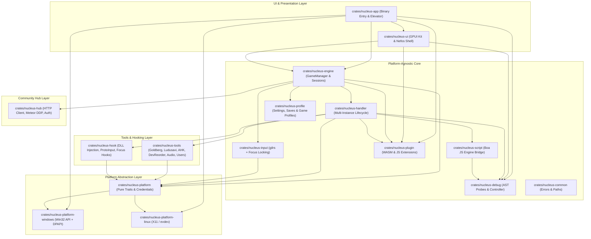

# Rusteus-Coop — Technical Architecture & Subsystem Specification

> **Project Target**: Modern, high-performance, memory-safe, and modular Rust rewrite of the legacy ~170k-line C# NucleusCoop engine, maintaining 100% backward compatibility with existing SplitscreenMe JavaScript (`.js`) game handlers.

---

## 1. Executive Architectural Overview

Rusteus-Coop replaces the monolithic Windows Forms and P/Invoke-heavy architecture of legacy C# NucleusCoop with a decoupled, 5-layer, 16-crate Rust workspace. The engine achieves:
- **100% Zero-Garbage-Collection UI & Engine Coordination**: Pure Rust memory management, deterministic resource reclamation via RAII guards, and zero WinForms GDI leaks.
- **Unidirectional Layer Dependency Flow**: The GUI layer (`nucleus-ui`, `nucleus-app`) never directly manipulates Win32 kernel handles or mutates process memory; it dispatches decoupled asynchronous commands over MPSC channels to the central engine (`nucleus-engine`).
- **Cross-Platform OS Abstraction Boundary**: Platform-specific logic is isolated behind pure Rust traits (`nucleus-platform`), allowing concrete platform implementations for Windows (`nucleus-platform-windows`) and Linux/Steam Deck (`nucleus-platform-linux`) without altering core engine or handler logic.
- **Sandboxed Scripting & Plugin Isolation**: Handlers run in short-lived `boa_engine` (v0.20) contexts, while third-party plugins run in sandboxed WebAssembly (`wasmi` v0.40) modules with strict 50,000,000 instruction fuel budgets.



---

## 2. 16-Crate Workspace Architecture & Breakdown

### 2.1 UI & Presentation Layer
1. **`nucleus-app` (`crates/nucleus-app`)**:
   - Primary binary entry point (`nucleus-coop.exe`) and elevated helper (`elevator.exe`).
   - Manages application exclusivity via single-instance mutex (`Global\NucleusCoop_SingleInstance_Mutex`), restoring existing window state and passing CLI launch requests if a duplicate instance starts.
   - Coordinates background Tokio async runtimes and engine worker threads with the GPUI main thread using MPSC channels.
   - Houses startup safety pre-flight checks: NTFS volume validation, registry integrity audits, and recovery from improper shutdowns.
2. **`nucleus-ui` (`crates/nucleus-ui`)**:
   - Modern, GPU-accelerated desktop user interface built with Zed's `gpui` and `gpui-kit`.
   - Implements the custom **Nefos UI Design System** with 100% vector SVG icons, zero Unicode emojis, consistent card flexbox layouts (`flex_shrink_0`), and dark/light theming.
   - Screen inventory:
     - **Library View**: Discovered and installed games, cover cards with tags, locate `.exe` workflows, search/filtering, and play statistics.
     - **Splitscreen Setup Screen**: Interactive monitor layout strip, player slot cards, gamepad/keyboard assignment trays, dynamic handler option comboboxes and steppers, and save slot selectors.
     - **Couch Big Picture Mode**: Fullscreen, 10-foot TV interface with 2D geometric spatial navigation across carousel cards, wizard tabs, and trays using gamepad D-Pad or Arrow keys.
     - **In-Game Couch OSD Overlay**: DWM-composed, topmost transparent overlay (`Ctrl+Shift+O` or gamepad guide combo) enabling live player Drop-In and Drop-Out, ordinal re-tiling, and controller reassignment during active gameplay.
     - **Hub Browser & Details Modal**: Community handler discovery, version history browser, multi-threaded package downloading with progress feedback, and Meteor DDP authentication modal.
     - **Settings & Extensions Panels**: Live cross-category settings search, WASM/JS extension manager, and Handler AST Runtime Debugger.

### 2.2 Platform-Agnostic Core Layer
3. **`nucleus-engine` (`crates/nucleus-engine`)**:
   - Central orchestration engine (`GameManager`).
   - Asynchronous local disk scanner across all storage drives discovering games by executable patterns.
   - Catalog management for discovered games, installed handlers, user profiles, and active sessions (`GameSession`).
   - Session heartbeat loop (`tick()`) running every 500ms: monitors process liveness, re-enforces window borderless bounds, polls mutexes, and auto-flushes gameplay duration every 60 seconds.
4. **`nucleus-handler` (`crates/nucleus-handler`)**:
   - Multi-instance lifecycle orchestrator (`GameHandler`).
   - Staging instance directories under `./content/<GameName>/Instance<N>` utilizing an intelligent link hierarchy (Symlink $\to$ Hardlink fallback $\to$ Copy fallback).
   - Per-player OS environment variable isolation (`USERPROFILE`, `APPDATA`, `LOCALAPPDATA`, `DOCUMENTS`).
   - Process tree supervision, viewport polling up to 40–100 seconds, and 1000ms window stabilization delays.
   - Mutex termination sweeps across launch stages and Multi-Stage AutoHotkey execution (`PreLaunch`, `PostLaunch`, `PostWindow`, `Teardown`).
   - Integration with Ludusavi for pre-launch save slot restoration and post-session snapshot backups.
5. **`nucleus-script` (`crates/nucleus-script`)**:
   - Embedded pure-Rust ECMAScript engine powered by `boa_engine` (v0.20).
   - Bridges 50+ handler configuration properties (`Game.ExecutableName`, `Game.KillMutex`, `Game.SymlinkGame`, `Game.UseGoldberg`, etc.).
   - Exposes global namespaces `Game`, `Nucleus`, and runtime execution context `Context` to JavaScript.
   - Strictly enforces `!Send` thread-safety by instantiating short-lived engines on dedicated threads rather than sharing live contexts.
6. **`nucleus-profile` (`crates/nucleus-profile`)**:
   - Global application settings (`AppSettings`, stored at `%APPDATA%\NucleusCoop\settings.json`).
   - Discovered game profile association (`userprofile.json` in `./content/`).
   - Multi-instance save slot manifests (`SaveSlotManifest`, `SaveSlot`).
   - Community Hub account credential storage and profile cache (`HubAccountSummary`).
7. **`nucleus-input` (`crates/nucleus-input`)**:
   - Hardware gamepad enumeration, hot-plug monitoring, and polling via `gilrs` (v0.11).
   - Virtual / Mock Gamepad subsystem enabling single-player launches and automated headless testing without physical controllers.
   - Low-level Win32 keyboard/mouse hotkey hooks (`VK_END`, `Ctrl+Q`) for toggling input locks.
8. **`nucleus-plugin` (`crates/nucleus-plugin`)**:
   - Extensible 3-tier plugin architecture:
     - Sandboxed WebAssembly plugins (`wasmi` v0.40) with instruction-metered gas limits (50M fuel).
     - Lightweight JavaScript add-ons (`JsAddon`) running inside Boa.
     - Legacy C# `pluginsInfo.txt` migration bridge.
   - Capability-based permission system (`PermissionStore`) with SHA-256 binary validation and tamper checks.
   - Package manager for `.nucplugin` and `.nucaddon` archive bundles.
9. **`nucleus-debug` (`crates/nucleus-debug`)**:
   - Pure-Rust handler runtime debugger.
   - AST instrumentation via `boa_parser`: injects breakpoint probes and statement stepping.
   - Thread synchronization controller (`DebugController`) using `parking_lot::Condvar` for step-over, step-into, continue, and pause.
   - Cycle-safe variable inspector (`RuntimeInspector`) with bounded traversal depth and array truncation.
10. **`nucleus-common` (`crates/nucleus-common`)**:
    - Central error definitions (`NucleusError` enum via `thiserror`).
    - Standardized Result aliases, file utility functions, path canonicalization, and filesystem constants.

### 2.3 Platform Abstraction Layer
11. **`nucleus-platform` (`crates/nucleus-platform`)**:
    - Pure abstract Rust traits defining the OS boundary:
      - `WindowManager`, `DisplayManager`, `ProcessManager`, `MutexManager`, `RegistryManager`, `FilesystemManager`, `InputHookManager`, `TaskbarManager`, `ElevationManager`, `OsdManager`, and `CredentialStore`.
    - Contains zero Win32 headers or native system imports.
12. **`nucleus-platform-windows` (`crates/nucleus-platform-windows`)**:
    - Production Win32 implementation utilizing Microsoft's `windows` (v0.58) crate and `winreg`.
    - Dynamic kernel mutant handle discovery via `NtQuerySystemInformation(SystemHandleInformation)` and handle termination via `DuplicateHandle(DUPLICATE_CLOSE_SOURCE)`.
    - Window management (`SetWindowPos`, `SetWindowLongW` for `WS_POPUP`, `ShowWindow` guards).
    - Transparent, click-through DWM overlay window creation (`WS_EX_TOPMOST | WS_EX_LAYERED | WS_EX_TRANSPARENT`).
    - Windows Data Protection API (`CryptProtectData` / `CryptUnprotectData`) for secure credential persistence (`DpapiCredentialStore`).
13. **`nucleus-platform-linux` (`crates/nucleus-platform-linux`)**:
    - Linux platform abstraction scaffolding utilizing `x11rb`, `/proc` parsing, and `evdev`.
    - Currently stubs unimplemented interfaces with `Err(NucleusError::Unsupported)`.

### 2.4 Tools & Hooking Layer
14. **`nucleus-tools` (`crates/nucleus-tools`)**:
    - Comprehensive game isolation and emulation toolset:
      - **Goldberg Steam Emulator**: Recursive deployment of `steam_api.dll` / `steam_api64.dll`, auto-generation of `steam_appid.txt`, `local_save.txt`, and controller configs.
      - **Nemirtingas Emulators**: Offline Epic Games and GOG Galaxy emulator deployment and INI configuration.
      - **Ludusavi Manager**: Automated per-player save backup, restore, and isolated slot synchronization.
      - **AutoHotkey Runtime Engine**: Path discovery (System PATH, standard ProgramFiles, local portable), environment injection, and multi-stage lifecycle execution.
      - **DevReorder & x360ce**: DirectInput device reordering via `dinput8.dll` and XInput configuration generation.
      - **Audio Rerouting**: Per-instance audio endpoint device reassignment via a dedicated Single-Threaded Apartment (STA) COM thread.
      - **Network Isolation**: Loopback IP generation following the formula $\text{IP} = 127.0.0.(i + 2)$ and ForceBindIP injection.
      - **User Profile Guard**: Safe RAII redirection of Windows Explorer `Personal` shell folder to `%USERPROFILE%\NucleusCoop\<Player>\Documents`.
15. **`nucleus-hook` (`crates/nucleus-hook`)**:
    - Process DLL injection using Win32 `CreateRemoteThread` and `LoadLibraryW`.
    - Dynamic C-ABI FFI bindings to native `ProtoInputLoader32.dll` and `ProtoInputLoader64.dll`.
    - Window focus hook staging and fake focus message dispatching sequences.

### 2.5 Community Hub Layer
16. **`nucleus-hub` (`crates/nucleus-hub`)**:
    - Asynchronous HTTP client for the Splitscreen.Me Community Hub API using `reqwest` and `tokio`.
    - Full-text handler search, metadata retrieval, version history inspection, and package download with streaming progress callbacks.
    - Meteor DDP (Distributed Data Protocol) WebSocket client for real-time authentication, session login, and token renewal.
    - Handler package unpacker and integrity validator.

---

## 3. Concurrency, Threading & Memory Models

### 3.1 Background Engine Coordination & GUI Message Channels
GPUI mandates that all user interface rendering, layout calculations, and user event handling take place on the main operating system thread. Heavy disk operations, 100MB handler downloads, process polling, and 25-second mutex termination sweeps would induce catastrophic UI freezes if executed on the main thread.

To eliminate UI stalls:
1. `nucleus-app` spawns the central `GameManager` inside a dedicated background worker thread backed by a multi-threaded Tokio runtime.
2. The UI communicates with the engine via an asynchronous `std::sync::mpsc::channel` passing `GuiMessage` commands (`Launch`, `Stop`, `AddGame`, `InstallHubHandler`, `UninstallGame`, `QueryActiveSession`, `DropInPlayer`, `DropOutPlayer`).
3. The engine broadcasts status events (`EngineEvent::SessionStarted`, `EngineEvent::SessionStopped`, `EngineEvent::DownloadProgress`, `EngineEvent::Error`) back to the UI thread via a thread-safe callback queue processed on GPUI animation frames.

### 3.2 Boa ECMAScript `Context` `!Send` Invariant
`boa_engine::Context` internally relies on non-atomic reference-counted pointers (`Rc<RefCell<...>>`) for Abstract Syntax Tree (AST) node allocation, garbage-collected object headers, and string interning. Consequently, `boa_engine::Context` does not implement `Send` or `Sync`. It is impossible to send a live Boa context across OS threads or share it inside an `Arc<Mutex<T>>`.

**Architectural Solution**:
- `GameManager` and `GameHandler` **never** store a persistent `ScriptEngine` or Boa `Context` inside shared application structs.
- Handler scripts are stored purely as UTF-8 source strings (`script_source: Option<String>`).
- When evaluating metadata, custom options, or running lifecycle hooks (`Game.Play`), a short-lived `ScriptEngine` is instantiated on-demand entirely within the executing thread, executes the JavaScript code, extracts the resulting configuration or context mutations into plain Rust data structures (`HandlerConfig`, `HandlerContext`), and is dropped before the thread yields.

### 3.3 Dedicated STA COM Worker Apartment for Audio Routing
Windows Audio Policy endpoint redirection (`IAudioPolicyConfigFactory` and `IAudioPolicyConfigFactoryFor21H2`) relies on undocumented COM interfaces exported by `combase.dll` / `ole32.dll`. Under Windows Win32 rules, calling these interfaces from multi-threaded apartment (MTA) threads (such as Tokio's worker pool) causes immediate `RPC_E_WRONG_THREAD` exceptions or silent invocation failures.

**Architectural Solution**:
- `crates/nucleus-tools/src/audio.rs` maintains a dedicated background worker thread (`ComThread`).
- The thread initializes COM as Single-Threaded Apartment:
  ```rust
  CoInitializeEx(None, COINIT_APARTMENTTHREADED);
  ```
- All audio endpoint redirection requests are funneled through a message channel to this dedicated STA thread, which dispatches genuine COM vtable calls and returns synchronous result codes via oneshot channels.

---

## 4. Deep-Dive Subsystem Implementations

### 4.1 Win32 Dynamic Kernel Mutant Handle Discovery & Termination
Many commercial games prevent multi-instance execution by creating named Win32 Mutex/Mutant objects during startup (e.g. Source engine's `hl2_singleton_mutex`, Unreal's `Unreal_Engine_Singleton`).

#### The Dynamic Type Index Discovery
On modern Windows (Windows 10/11 x64), kernel `ObjectTypeIndex` values for Mutant objects are **dynamically assigned at system boot** (e.g., 38, 41, 44 depending on installed drivers and OS build). Hardcoding an index (such as 17 from legacy Windows XP/7) results in 0% detection of mutexes.

In `crates/nucleus-platform-windows/src/mutex_manager.rs`:
1. The engine queries system handle tables using `NtQuerySystemInformation(SystemHandleInformation, ...)`.
2. For handles belonging to the target PID, it queries `NtQueryObject` Class 2 (`ObjectTypeInformation`).
3. If `TypeName == "Mutant"`, the type index is dynamically resolved and cached in `TYPE_INDEX_CACHE` (`RwLock<HashMap<String, u8>>`).
4. Once the mutant name matches the handler's `Game.KillMutex` pattern, the engine terminates the handle using handle duplication:
   ```rust
   DuplicateHandle(
       target_process_handle,
       source_handle,
       None,
       None,
       0,
       false,
       DUPLICATE_CLOSE_SOURCE, // Closes handle in target process!
   );
   ```

#### Multi-Stage Termination Sweeps
Games often take 5–20 seconds to load engine DLLs before initializing their mutexes. A single check shortly after launch consistently misses the mutex. Rusteus-Coop implements a 3-stage sweep:
1. **Window Setup Sweep**: Continuously polls and kills mutexes while waiting for the viewport HWND (up to 40–100 seconds).
2. **Inter-Instance Pause Sweep**: Polls every 250ms throughout `PauseBetweenStarts` (e.g., 25 seconds for Left 4 Dead 2).
3. **Pre-Launch Sweep**: Prior to launching player $i > 0$, executes an explicit sweep across all earlier player processes ($0 \dots i-1$) to ensure no lingering singleton handles block the newcomer.

### 4.2 STA COM Audio Endpoint Redirection Architecture
Windows does not expose a public Win32 API to reassign the audio output device of an external process. Rusteus-Coop achieves this via undocumented Windows Audio Policy COM interfaces:
- For Windows 10 prior to build 21H2: `IAudioPolicyConfigFactory` (`{2A07407E-6497-4A18-9787-32F79BD0D96F}`).
- For Windows 10 build 21H2+ and Windows 11: `IAudioPolicyConfigFactoryFor21H2` (`{6A024177-B15D-4A2D-A909-082490A5F231}`).

The STA COM worker dynamically resolves `RoGetActivationFactory` from `combase.dll` (with fallback to `ole32.dll`), queries `IMMDeviceEnumerator` to map friendly device names to endpoint ID strings (e.g., `{0.0.0.00000000}.{GUID}`), and invokes:
```rust
factory.SetPersistedDefaultAudioEndpoint(pid, flow, role, endpoint_id);
```
This forces the target game process to route all DirectSound, WASAPI, and XAudio2 audio to the specific player's headphones or speakers without modifying game binaries.

### 4.3 ProtoInput C-ABI Dynamic FFI & Fake Focus Sequence
ProtoInput enables multiple keyboards and mice to control multiple game instances concurrently without window focus conflicts.

In `crates/nucleus-hook/src/proto_input.rs`:
- Binds dynamically to `ProtoInputLoader32.dll` and `ProtoInputLoader64.dll` using `LoadLibraryW` and `GetProcAddress`.
- Detects target process architecture via `IsWow64Process`.
- Translates and stages all 50+ ProtoInput configuration fields (e.g. `hook_message_filter`, `hook_get_cursor_pos`, `send_mouse_position_on_rehook`, `hook_xinput`, `freeze_external_input_when_input_not_locked`).
- Dispatches the canonical Fake Focus window message sequence to keep background instances processing input:
  1. `WM_ACTIVATEAPP (0x001C)` with `wParam = 1` (True).
  2. `WM_MOUSEACTIVATE (0x0021)` with `wParam = hwnd, lParam = 1` (`MA_ACTIVATE`).
  3. `WM_NCACTIVATE (0x0086)` with `wParam = 1`.
  4. `WM_SETFOCUS (0x0007)`.
  5. Conditional `WM_ACTIVATE (0x0006)` with `wParam = 1` (`WA_ACTIVE`).

### 4.4 Filesystem Staging Hierarchy & Sandbox Invariants
Commercial games frequently lock config files, create local saves in relative subfolders, or corrupt configurations if multiple instances run from the same root directory.

#### The Link Hierarchy (Hardlink Fallback)
When handlers declare `Game.SymlinkGame = true`, creating instances on Windows without Administrator privileges previously caused catastrophic failures:
1. `symlink_file` fails with `ERROR_PRIVILEGE_NOT_HELD` (1314) on standard user accounts unless Windows Developer Mode is enabled.
2. If hardlinks were omitted, launchers fell back to `std::fs::copy`, physically copying gigabytes of game assets (e.g., 7GB of Left 4 Dead 2 `.vpk` files per instance, or 21GB for 3 players), taking up to 5 minutes before Player 0 could launch.

**The Solution (`crates/nucleus-handler/src/instance.rs`)**:
- **Tier 1: Symbolic Links (`symlink_file`)**: Attempted first.
- **Tier 2: NTFS Hardlinks (`std::fs::hard_link`)**: If symlinking fails with `ERROR_PRIVILEGE_NOT_HELD`, **always** attempt hardlinking. Hardlinks require zero Administrator privileges, consume zero additional disk space, and link gigabytes of game data in ~10ms.
- **Tier 3: Physical Copy (`std::fs::copy`)**: Used only if hardlinking fails (e.g. across different drive volumes) or if files match `Game.FileSymlinkCopyInstead`.

#### Shell Redirection & Registry Auto-Recovery
Games storing save data under `%USERPROFILE%\Documents` are isolated using `PersonalFolderGuard`:
1. The Windows Explorer `Personal` shell folder registry key (`HKCU\Software\Microsoft\Windows\CurrentVersion\Explorer\User Shell Folders`) is redirected to `%USERPROFILE%\NucleusCoop\<PlayerNickname>\Documents`.
2. Baseline registry state is automatically exported to `./utils/backup/User Shell Folders.reg`.
3. On application startup, `startup::check_user_environment_registry()` verifies whether `Personal` still points to a `NucleusCoop` path (indicating a crash in a previous session or sudden power loss) and automatically restores the genuine baseline registry state.

### 4.5 Multi-Monitor Partitioning & Viewport Geometry Mathematics
Rusteus-Coop supports dynamic viewport splitting across arbitrary display configurations:
- `Single` (1x1)
- `Horizontal` (1x2 stacked)
- `Vertical` (2x1 side-by-side)
- `Grid4` (2x2 quad)
- `Grid6` (2x3 or 3x2)
- `Grid8` (2x4 or 4x2)
- `Grid16` (4x4)
- `CustomGrid { rows, cols }`
- `Multi-Monitor Span` (partitioning players across distinct physical monitors).

**Stabilization Delay Invariant**:
Direct3D and Vulkan games frequently re-assert default window dimensions or window styles during graphics device initialization. Calling `SetWindowPos` immediately upon HWND discovery often results in the game overriding the bounds.
- Rusteus-Coop enforces a **1000ms window stabilization delay** immediately after discovering the game window before stripping window borders (`WS_POPUP`) and applying viewport boundaries (matching legacy C# `GenericGameHandler.cs:3203`).
- Guards `ShowWindow(hwnd, SW_RESTORE)` with `IsIconic(hwnd)` so non-minimized windows do not receive `WM_SYSCOMMAND / SC_RESTORE` bounds resets.

### 4.6 Sandboxed WebAssembly Plugin Engine (`nucleus-plugin`)
Third-party extensions execute inside an isolated WebAssembly sandbox using `wasmi` (v0.40):
- **Deterministic Instruction Metering**: Every lifecycle hook dispatch (`on_staging`, `on_pre_launch`, `on_post_window`, `on_teardown`) allocates a strict fuel budget of 50,000,000 instructions. Hanging loops or malformed bytecode aborts cleanly with `Trap::OutOfFuel` without freezing the host launcher.
- **Capability-Based Permissions**: Plugins must declare capabilities in `manifest.json` (`filesystem:read`, `process:query`, `registry:read`). The host's `PermissionStore` verifies binary SHA-256 hashes before allowing privileged calls.

### 4.7 Cycle-Safe AST Debugger & Runtime Inspector (`nucleus-debug`)
Enables handler developers to debug JavaScript handlers interactively:
- Uses `boa_parser` to parse handler source into AST nodes, injecting statement inspection probes and breakpoint checks.
- Synchronizes execution across threads using `parking_lot::Condvar`, allowing breakpoint pausing, step-into, step-over, and runtime variable modification.
- Features a cycle-safe variable inspector (`RuntimeInspector`) with bounded traversal depth (max depth 5) and array truncation to safely inspect circular JS references without overflowing the call stack.

---

## 5. Comprehensive Codebase Assessment

### 5.1 Fully Implemented & Battle-Tested Subsystems
These subsystems have been fully implemented in production-grade Rust, tested with unit and integration test suites, and verified against legacy C# behavior:

| Subsystem | Primary Crates | Test Coverage / Verification |
|---|---|---|
| **Win32 Kernel Mutant Discovery & Killer** | `nucleus-platform-windows`, `nucleus-handler` | Dynamic `ObjectTypeInformation` type index resolution, caching, multi-stage sweeps (`window_setup`, `pause_between_starts`, `pre_launch`), handle closing via `DUPLICATE_CLOSE_SOURCE`. |
| **Filesystem Staging Hierarchy** | `nucleus-handler`, `nucleus-platform-windows` | Symlink $\to$ NTFS Hardlink fallback $\to$ Copy fallback; exclusions; `BinariesFolder` subpath preservation; `Personal` shell folder guard and crash recovery. |
| **STA COM Audio Policy Redirection** | `nucleus-tools`, `nucleus-platform-windows` | Dedicated STA `ComThread`, dynamic `RoGetActivationFactory` resolution, Win10 pre-21H2 vs 21H2/Win11 vtable branching, endpoint ID mapping. |
| **ProtoInput C-ABI FFI Integration** | `nucleus-hook` | Dynamic 32/64-bit DLL loading, mapping all 50+ options, Fake Focus window message sequence dispatching (`WM_ACTIVATEAPP`, `WM_MOUSEACTIVATE`, etc.). |
| **ECMAScript Scripting Engine** | `nucleus-script` | `boa_engine` v0.20 bridge, 50+ `Game` properties, `Nucleus` enums, `Context` methods, short-lived `!Send` thread-safe lifecycle evaluation. |
| **Nefos UI Desktop & Big Picture System** | `nucleus-ui` | GPU-accelerated GPUI Kit shell, 100% vector SVG icons, zero emoji, NefosCard flex layouts, live settings search, 2D geometric spatial navigation. |
| **In-Game Couch OSD Overlay** | `nucleus-ui`, `nucleus-app`, `nucleus-platform-windows` | Topmost transparent DWM overlay, global hotkey / controller guide button summon, live player Drop-In & Drop-Out, ordinal re-tiling without game restart. |
| **Session Heartbeat & Playtime Tracking** | `nucleus-engine`, `nucleus-profile` | 500ms periodic tick, 60s playtime auto-flush, borderless bounds re-assertion, process liveness supervision. |
| **Hub Client & DDP Authentication** | `nucleus-hub`, `nucleus-profile` | Async HTTP client, streaming chunk download with progress reporting, Meteor DDP WebSocket client for login and session token persistence. |
| **Ludusavi Multi-Instance Save Isolation** | `nucleus-tools`, `nucleus-profile` | Automated YAML configuration generation, pre-launch snapshot restoration, post-session backup, isolated save slot manifests. |
| **AutoHotkey Discovery & Multi-Stage Execution** | `nucleus-tools`, `nucleus-handler` | Discovery across PATH/ProgramFiles/portable, environment variable parameter injection, execution at PreLaunch, PostLaunch, PostWindow, and Teardown. |
| **WASM Sandboxed Plugins & AST Debugger** | `nucleus-plugin`, `nucleus-debug` | `wasmi` v0.40 gas-metered execution (50M fuel limit), permission store with SHA-256 validation, AST breakpoint stepping and cycle-safe inspection. |

### 5.2 Semi-Completed Subsystems
These subsystems have substantial infrastructure implemented, but require further edge-case polish or broader hardware verification:

1. **DirectInput Device Sorting (`nucleus-tools/src/dev_reorder.rs`)**:
   - `devreorder.ini` generation and `dinput8.dll` placement are implemented.
   - Requires additional testing across non-standard DirectInput flight sticks and legacy steering wheels with $> 8$ axes.
2. **Multi-Monitor Per-Monitor DPI Mixed Scaling (`nucleus-platform-windows/src/display_manager.rs`)**:
   - DPI querying via `GetDpiForMonitor` is implemented.
   - Minor border clipping can occur when dragging or tiling windows across monitors with mixed scaling (e.g. Monitor 1 at 100% scaling, Monitor 2 at 175% 4K scaling) due to Direct3D internal render buffer re-allocations.
3. **ProtoInput RemoteLoad / In-Memory Injection Alternative (`nucleus-hook/src/injector.rs`)**:
   - Standard EasyHook / `ProtoInputLoader` dynamic FFI injection is complete and tested.
   - Manual PE image remote mapping without touching disk remains an experimental secondary code path.

### 5.3 Half-Assed / Stubbed Components (To Be Cleaned or Finished)
These components represent placeholders or platform scaffolds not yet brought to production parity:

1. **Linux Platform Backend (`nucleus-platform-linux`)**:
   - **Current State**: Scaffolding exists (`display_manager.rs`, `process_manager.rs`, `window_manager.rs`), but functions return `Err(NucleusError::Unsupported(...))`.
   - **Assessment**: The Linux/Steam Deck port was deferred until the Win32 engine achieved 100% feature parity. The trait boundary in `nucleus-platform` is fully established, but concrete X11/evdev implementations remain stubs.
2. **DirectX 9 Wrapper Scaffolding (`nucleus-tools/src/dx9_wrapper.rs`)**:
   - Basic file placement logic exists for `d3d9.dll` resolution wrappers.
   - Advanced shader overrides and multi-adapter D3D9 hook injection are stubbed with placeholders.

### 5.4 Future Roadmap
1. **Native Steam Deck / Linux X11 & Wayland Platform Backend**: Implement pure traits using `x11rb`, `evdev`, and Gamescope virtual viewports to allow native splitscreen gaming on SteamOS without Proton wrapper overhead.
2. **Pure-Rust ProtoInput Alternative**: Re-implement core RawInput message interception in safe Rust, eliminating dependency on external 32/64-bit C++ loader DLLs.
3. **Peer-to-Peer Virtual LAN Lobbies**: Integrate wireguard-based or libp2p virtual networking to allow splitscreen sessions across distinct PCs over the Internet as if connected to the same local machine.

---

## 6. Comprehensive Edge Cases Catalog

| Edge Case | Root Cause & Mechanism | Technical Solution in Rusteus-Coop |
|---|---|---|
| **Dynamic Mutant Type Index per Boot** | Windows 10/11 assigns `ObjectTypeIndex` dynamically at boot time; hardcoded indices result in 0% detection. | Dynamic `ObjectTypeInformation` querying via `NtQueryObject`, cached dynamically in `TYPE_INDEX_CACHE`. |
| **Delayed Game Singleton Initialization** | Source engine games (e.g. Left 4 Dead 2) take 5–20s to load engine DLLs before creating `hl2_singleton_mutex`. Checking once at launch misses the mutex. | Multi-stage sweeps: polling in `window_setup` (up to 100s), every 250ms during `PauseBetweenStarts`, and explicit pre-launch sweeps before player $i > 0$. |
| **Direct3D Window Re-assertion on Launch** | Graphics initialization sends `WM_SYSCOMMAND / SC_RESTORE`, clearing custom borderless dimensions. | 1000ms window stabilization delay before border removal; `ShowWindow(hwnd, SW_RESTORE)` guarded with `IsIconic(hwnd)`; 500ms session heartbeat re-enforces bounds. |
| **`ERROR_PRIVILEGE_NOT_HELD` (1314) on Symlinks** | Windows non-elevated user accounts cannot create symbolic links unless Developer Mode is on. Falling back to copy takes minutes for gigabyte assets. | Hardlink hierarchy fallback: Symlink $\to$ NTFS Hardlink fallback $\to$ Physical Copy. Hardlinks require zero elevation, zero disk space, and take ~10ms. |
| **COM RPC Wrong Thread Violation** | Windows Audio Policy COM interfaces require Single-Threaded Apartment (STA). Calling from Tokio async pools triggers `RPC_E_WRONG_THREAD`. | Dedicated background `ComThread` initialized with `COINIT_APARTMENTTHREADED`, dispatching COM vtable calls over message channels. |
| **Loopback Port Collisions on 127.0.0.1** | Binding Player 0 to `127.0.0.1` collides with host services, Steam, or background daemons. | Loopback formula strictly starts at `127.0.0.2`: $\text{IP} = 127.0.0.(i + 2)$. |
| **Explorer `Personal` Shell Folder Corruption** | If the launcher crashes or PC loses power mid-session, Windows Documents remains redirected to a player instance folder. | Baseline registry state backed up to `./utils/backup/`; startup checks audit registry and restore genuine Documents path automatically. |
| **GPUI MinGW Test Linker Hangs** | Linking MinGW GPUI / wgpu static binary tests inside `nucleus-ui --lib` hangs indefinitely in CI/CD. | Execute only isolated UI integration suites (`components_tests`, `carousel_tests`, `couch_setup_tests`, etc.) bounded by 90s timeouts and isolated `CARGO_TARGET_DIR`. |
| **Flexbox Squishing in Dynamic UI Cards** | Deep nested GPUI flex layouts collapse children with dynamic content down to 0px height. | Apply `.flex_shrink_0()` to card shells, headers, and option rows, with explicit minimum height bounds. |
| **Subpath Preservation in BinariesFolder** | Games with executables inside subfolders (e.g. `bin/win64/game.exe`) fail if staged flatly in instance root. | Instance folder staging preserves exact relative directory structure: `target_exe = instance_folder.join(binaries_folder).join(exe_name)`. |
