# Arbitrary DLL Injection & Bidirectional Inter-Process Interaction Implementation Plan

> **For agentic workers:** REQUIRED SUB-SKILL: Use superpowers:subagent-driven-development (recommended) or superpowers:executing-plans to implement this plan task-by-task. Steps use checkbox (`- [x]`) syntax for tracking.

**Goal:** Provide Nucleus Co-op game handlers with the ability to inject arbitrary DLLs into specific game instances at configurable lifecycle stages (startup suspended, post-startup, window created, delayed, or manual), verify PE binary architectures, safely invoke remote exports with custom arguments, establish bidirectional IPC (Named Pipes & Shared Memory), and perform direct in-process memory manipulation (AOB pattern scanning, pointer chain resolving, memory freezing) — completely eliminating the need for manual Cheat Engine workflows.

**Architecture:** A layered, memory-safe subsystem spanning `nucleus-common` (types & configs), `nucleus-hook` (safe Win32 PE parsing, RAII remote memory allocation guards, SEH crash-resilient remote thread execution, Tokio named pipes, shared memory, and AOB memory engine), `nucleus-platform` / `nucleus-platform-windows` (abstract traits, suspended process creation, privilege escalation via `elevator.exe`), `nucleus-script` (declarative `Game.InjectedDlls` & dynamic `Context` injection/IPC/memory APIs), and `nucleus-handler` (lifecycle trigger points, instance targeting, and teardown).

**Tech Stack:** Rust 2024, Win32 API (`windows` 0.58: `CreateRemoteThread`, `LoadLibraryW`, `VirtualAllocEx`, `WriteProcessMemory`, `CreateNamedPipeW`, `CreateFileMappingW`), `tokio` (async named pipes), `boa_engine` 0.20 (ECMAScript bridge), `thiserror`, `serde`/`serde_json`, `tracing`.

**Spec:** In-tree architecture & parity requirements defined in [AGENTS.md](file:///c:/Users/Derwins8A/Desktop/NucleusCoopRustRewrite/AGENTS.md) and [nucleus-coop-parity](file:///c:/Users/Derwins8A/Desktop/NucleusCoopRustRewrite/.agents/skills/nucleus-coop-parity/SKILL.md).

---

## Global Constraints

1. **Zero Stubbing Invariant**: No placeholder returns, no empty functions, and no `todo!()` or `unimplemented!()` macros. Every function must execute genuine, production-ready logic.
2. **Strict Thread Safety (`!Send` Boa Context)**: `boa_engine::Context` is `!Send`. Never pass Boa contexts or JavaScript objects across threads; execute script evaluation on dedicated worker threads.
3. **PE Bitness & Architecture Validation**: Every injection attempt must pre-inspect the target DLL's PE header (`IMAGE_FILE_HEADER.Machine`) and target process bitness (`IsWow64Process`) before touching remote memory to prevent fatal `0xC0000005` or `ERROR_BAD_EXE_FORMAT (193)` crashes.
4. **Remote Memory RAII Safety**: Any memory allocated in a target process via `VirtualAllocEx` must be wrapped in a Rust RAII guard (`RemoteMemoryGuard`) that automatically releases memory via `VirtualFreeEx(MEM_RELEASE)` on any failure, panic, or early return.
5. **Target Process Crash Isolation**: Remote thread execution (`CreateRemoteThread`) must never block indefinitely. Polling loops must monitor process liveness (`GetExitCodeProcess`) and detect `DllMain` crashes or access violations.
6. **Windows Target Directory Isolation**: All cargo commands must use isolated target directories (e.g. `$env:CARGO_TARGET_DIR="target_hook"`) to prevent MSVC/MinGW file locks.
7. **Zero Disruption to Existing Handlers**: 100% backward compatibility with existing `.js` handlers; declarative properties like `Game.InjectedDlls` and dynamic `Context` APIs are strictly additive.

---

## Review Focus

1. **Architecture Mismatch Prevention (x86 vs x64)**: A user configures a 64-bit DLL for a 32-bit (WOW64) game (or vice-versa). The system must inspect PE headers, abort before remote allocation, and log a clear diagnostic error without crashing target or host.
2. **Privilege & Integrity Elevation (`ERROR_ACCESS_DENIED`)**: Target process is running elevated (Administrator) while Nucleus is unprivileged. `OpenProcess` fails with error code 5. The engine must request minimal necessary rights (`PROCESS_CREATE_THREAD | PROCESS_VM_OPERATION | ...`), attempt token privilege adjustment (`SeDebugPrivilege`), and fall back to the standalone `elevator.exe` helper.
3. **Target `DllMain` Deadlock or Crash**: An injected DLL crashes inside `DllMain` (e.g. null pointer dereference) or deadlocks on loader lock. The injector must poll with a bounded timeout, detect process termination, capture the exit/SEH code, and prevent launcher freeze.
4. **DLL Dependency Resolution**: An injected DLL resides in a subfolder with dependent DLLs. Standard `LoadLibraryW` fails if the DLL directory is not in the search path. The injector must optionally call `SetDllDirectoryW` in the remote process or stage dependencies into the instance directory.
5. **Named Pipe IPC Disconnect & Buffer Overflow**: Injected DLL crashes or closes its pipe endpoint mid-game. Tokio named pipe server must handle disconnects gracefully without panic, and buffer frames with bounded limits to prevent unbounded memory growth.

---

## Swarm Orchestration Waves

```mermaid
graph TD
    subgraph Wave1["Wave 1: Foundation Types & Platform Abstractions"]
        W1_1["Subagent 1.1: Common Data Models & Enums<br/>(crates/nucleus-common)"]
        W1_2["Subagent 1.2: Abstract Platform Traits<br/>(crates/nucleus-platform)"]
    end

    subgraph Wave2["Wave 2: Safe Win32 Injection & PE Inspection"]
        W2_1["Subagent 2.1: Pure-Rust PE Header Inspector<br/>(crates/nucleus-hook/src/pe_inspector.rs)"]
        W2_2["Subagent 2.2: Memory-Safe Remote Injector & RAII Guard<br/>(crates/nucleus-hook/src/injector.rs)"]
        W2_3["Subagent 2.3: Remote Export RPC & Ejection Engine<br/>(crates/nucleus-hook/src/remote_call.rs)"]
    end

    subgraph Wave3["Wave 3: Real-Time IPC & Memory Manipulation Engine"]
        W3_1["Subagent 3.1: Async Tokio Named Pipe IPC Server<br/>(crates/nucleus-hook/src/ipc/named_pipe.rs)"]
        W3_2["Subagent 3.2: Shared Memory Telemetry Buffer<br/>(crates/nucleus-hook/src/ipc/shared_memory.rs)"]
        W3_3["Subagent 3.3: In-Process Memory Engine (AOB & Pointers)<br/>(crates/nucleus-hook/src/memory_engine.rs)"]
    end

    subgraph Wave4["Wave 4: ECMAScript Bridge & Handler Integration"]
        W4_1["Subagent 4.1: Game.InjectedDlls Handler Configuration<br/>(crates/nucleus-script/src/handler_config.rs)"]
        W4_2["Subagent 4.2: Context Injection, IPC & Memory Bridge<br/>(crates/nucleus-script/src/bridge.rs)"]
    end

    subgraph Wave5["Wave 5: Lifecycle Orchestration & Session Watchdog"]
        W5_1["Subagent 5.1: Multi-Stage Launch Hooks in GameHandler<br/>(crates/nucleus-handler/src/game_handler.rs)"]
        W5_2["Subagent 5.2: IPC Session Dispatcher & Memory Freezing<br/>(crates/nucleus-engine/src/game_session.rs)"]
    end

    subgraph Wave6["Wave 6: End-to-End Verification & Verification Suite"]
        W6_1["Subagent 6.1: Mock Injected DLL & Integration Tests<br/>(nucleus-hook/tests, nucleus-handler/tests)"]
        W6_2["Subagent 6.2: Sample JS Handler & Diagnostic Verification"]
    end

    Wave1 -->|Integration Gate: cargo test -p nucleus-common -p nucleus-platform| Wave2
    Wave2 -->|Integration Gate: cargo test -p nucleus-hook -p nucleus-platform-windows| Wave3
    Wave3 -->|Integration Gate: cargo test -p nucleus-hook| Wave4
    Wave4 -->|Integration Gate: cargo test -p nucleus-script| Wave5
    Wave5 -->|Integration Gate: cargo test -p nucleus-handler -p nucleus-engine| Wave6
    Wave6 -->|Final Workspace Gate: 100% Tests Pass across all 14 crates| Done([Complete])
```



---

## File Structure & Subsystem Responsibilities

| Subsystem | File Path | Responsibility |
|---|---|---|
| **Common (Models)** | `crates/nucleus-common/src/dll_injection.rs` [NEW] | `DllInjectionConfig`, `InjectionTiming`, `InjectionMethod`, `TargetInstanceFilter`, `IpcChannelKind` |
| **Common (Export)** | `crates/nucleus-common/src/types.rs` [MODIFY] | Re-export DLL injection configuration types |
| **Common (Errors)** | `crates/nucleus-common/src/error.rs` [MODIFY] | Add `NucleusError::DllInjection`, `NucleusError::PeInspection`, `NucleusError::Ipc` |
| **Platform (Traits)** | `crates/nucleus-platform/src/dll_manager.rs` [NEW] | Abstract `DllInjectionManager`, `ProcessMemoryManager`, `IpcManager` traits |
| **Platform (Export)** | `crates/nucleus-platform/src/lib.rs` [MODIFY] | Register and export DLL and memory manager traits |
| **Platform (Windows)** | `crates/nucleus-platform-windows/src/dll_manager.rs` [NEW] | Concrete Win32 implementation of DLL injection and memory protection |
| **Hook (PE Inspector)** | `crates/nucleus-hook/src/pe_inspector.rs` [NEW] | Safe in-tree PE header reader, machine architecture checker, export directory parser |
| **Hook (Remote Alloc)** | `crates/nucleus-hook/src/remote_memory.rs` [NEW] | RAII `RemoteMemoryGuard` with automatic `VirtualFreeEx` cleanup on drop |
| **Hook (Injector)** | `crates/nucleus-hook/src/injector.rs` [MODIFY] | Overhaul with bitness pre-flight, SEH timeout detection, exit code inspection |
| **Hook (Remote RPC)** | `crates/nucleus-hook/src/remote_call.rs` [NEW] | Execute exported functions with serialized payloads in target process |
| **Hook (Named Pipe)** | `crates/nucleus-hook/src/ipc/named_pipe.rs` [NEW] | Asynchronous Tokio Named Pipe server with length-prefixed JSON protocol |
| **Hook (Shared Mem)** | `crates/nucleus-hook/src/ipc/shared_memory.rs` [NEW] | Fast memory-mapped file telemetry buffer with Win32 event synchronization |
| **Hook (Memory Engine)**| `crates/nucleus-hook/src/memory_engine.rs` [NEW] | Cheat Engine parity: Read/write, AOB pattern scanning, pointer chain resolver |
| **Hook (Library Root)** | `crates/nucleus-hook/src/lib.rs` [MODIFY] | Export new injector, memory engine, IPC, and PE inspection primitives |
| **Script (Config)** | `crates/nucleus-script/src/handler_config.rs` [MODIFY] | Add `injected_dlls: Vec<DllInjectionConfig>` to `HandlerConfig` |
| **Script (Engine)** | `crates/nucleus-script/src/engine.rs` [MODIFY] | Parse `Game.InjectedDlls` array and bind `Game.AddInjectedDll(...)` |
| **Script (Context)** | `crates/nucleus-script/src/handler_context.rs` [MODIFY] | Store per-instance injection states, named pipe handle, and shared memory name |
| **Script (Bridge)** | `crates/nucleus-script/src/bridge.rs` [MODIFY] | Bind `Context.InjectDll`, `Context.SendDllMessage`, `Context.ReadMemory*`, `Context.WriteMemory*`, `Context.ScanMemory` |
| **Handler (Orchestration)**| `crates/nucleus-handler/src/game_handler.rs` [MODIFY] | Multi-stage injection triggers: startup suspended, post-launch, window created, delayed |
| **Handler (Teardown)** | `crates/nucleus-handler/src/game_handler.rs` [MODIFY] | Clean session shutdown: DLL ejection, named pipe disconnection, resource cleanup |
| **Engine (Session)** | `crates/nucleus-engine/src/game_session.rs` [MODIFY] | Background heartbeat tick: IPC routing, memory freezing loop, crash detection |

---

## Detailed Step-by-Step Implementation Tasks

### Task 1: Common Layer — DLL Injection Models, Enums & Error Variants

**Files:**
- Create: `crates/nucleus-common/src/dll_injection.rs`
- Modify: `crates/nucleus-common/src/types.rs`
- Modify: `crates/nucleus-common/src/error.rs`
- Test: `crates/nucleus-common/tests/dll_injection_types_test.rs`

**Interfaces:**
- Consumes: `serde::{Serialize, Deserialize}`, `thiserror::Error`.
- Produces: `DllInjectionConfig`, `InjectionTiming`, `InjectionMethod`, `TargetInstanceFilter`, `IpcChannelKind`, `NucleusError::DllInjection(String)`.

- [x] **Step 1: Write failing unit tests for configuration serialization and deserialization**
  Create `crates/nucleus-common/tests/dll_injection_types_test.rs` testing JSON roundtrip of `DllInjectionConfig` across all timing and method variants:
  ```rust
  use nucleus_common::dll_injection::{DllInjectionConfig, InjectionTiming, InjectionMethod, TargetInstanceFilter, IpcChannelKind};

  #[test]
  fn test_dll_injection_config_json_roundtrip() {
      let cfg = DllInjectionConfig {
          path: "mods/test.dll".to_string(),
          target_instances: TargetInstanceFilter::Specific(vec![0, 1]),
          timing: InjectionTiming::OnWindowCreated,
          delay_ms: 1000,
          architecture: nucleus_common::dll_injection::TargetArchitecture::Auto,
          method: InjectionMethod::CreateRemoteThread,
          export_name: Some("InitMod".to_string()),
          export_argument: Some("instance_id=1".to_string()),
          required: true,
          ipc_channel: IpcChannelKind::NamedPipe,
          pipe_name: Some(r"\\.\pipe\TestPipe".to_string()),
          eject_on_close: true,
      };
      let json = serde_json::to_string(&cfg).unwrap();
      let deserialized: DllInjectionConfig = serde_json::from_str(&json).unwrap();
      assert_eq!(cfg, deserialized);
  }
  ```

- [x] **Step 2: Run test to verify it fails**
  Run: `$env:CARGO_TARGET_DIR="target_common"; cargo test --manifest-path nucleus-coop/Cargo.toml -p nucleus-common --test dll_injection_types_test`
  Expected: FAIL (module `dll_injection` does not exist).

- [x] **Step 3: Implement data models in `nucleus-common/src/dll_injection.rs`**
  Implement `DllInjectionConfig`, `InjectionTiming`, `InjectionMethod`, `TargetInstanceFilter`, `TargetArchitecture`, `IpcChannelKind`. Add `NucleusError::DllInjection(String)`, `NucleusError::PeInspection(String)`, and `NucleusError::Ipc(String)` in `nucleus-common/src/error.rs`.

- [x] **Step 4: Run test to verify it passes**
  Run: `$env:CARGO_TARGET_DIR="target_common"; cargo test --manifest-path nucleus-coop/Cargo.toml -p nucleus-common --test dll_injection_types_test`
  Expected: PASS.

- [x] **Step 5: Git commit**
  ```bash
  git add nucleus-coop/crates/nucleus-common/
  git commit -m "feat(common): add DLL injection configuration models, IPC enums, and error variants"
  ```

---

### Task 2: Platform Layer — Pure Abstract Traits for DLL Injection & Remote Memory

**Files:**
- Create: `crates/nucleus-platform/src/dll_manager.rs`
- Modify: `crates/nucleus-platform/src/platform_services.rs`
- Modify: `crates/nucleus-platform/src/lib.rs`
- Test: `crates/nucleus-platform/tests/trait_compilation_test.rs`

**Interfaces:**
- Consumes: `nucleus-common::dll_injection::*`, `nucleus-common::error::*`.
- Produces: `DllInjectionManager`, `ProcessMemoryManager` traits exposed through `PlatformServices`.

- [x] **Step 1: Write trait compilation test**
  In `trait_compilation_test.rs`, define mock implementations of `DllInjectionManager` and `ProcessMemoryManager` to ensure object safety and `Send + Sync` guarantees.

- [x] **Step 2: Run test to verify failure**
  Run: `$env:CARGO_TARGET_DIR="target_plat"; cargo test --manifest-path nucleus-coop/Cargo.toml -p nucleus-platform --test trait_compilation_test`
  Expected: FAIL.

- [x] **Step 3: Define traits in `crates/nucleus-platform/src/dll_manager.rs`**
  ```rust
  pub trait DllInjectionManager: Send + Sync {
      fn inject_dll(&self, pid: u32, config: &DllInjectionConfig) -> NucleusResult<usize>;
      fn call_export(&self, pid: u32, module_handle: usize, export: &str, arg: &str) -> NucleusResult<u32>;
      fn eject_dll(&self, pid: u32, module_handle: usize) -> NucleusResult<()>;
  }

  pub trait ProcessMemoryManager: Send + Sync {
      fn read_memory(&self, pid: u32, address: usize, buffer: &mut [u8]) -> NucleusResult<usize>;
      fn write_memory(&self, pid: u32, address: usize, data: &[u8]) -> NucleusResult<usize>;
      fn virtual_protect(&self, pid: u32, address: usize, size: usize, new_protect: u32) -> NucleusResult<u32>;
  }
  ```
  Add methods to `PlatformServices` trait with default fallbacks returning errors on platforms lacking implementation.

- [x] **Step 4: Run test to verify pass**
  Run: `$env:CARGO_TARGET_DIR="target_plat"; cargo test --manifest-path nucleus-coop/Cargo.toml -p nucleus-platform --test trait_compilation_test`
  Expected: PASS.

- [x] **Step 5: Git commit**
  ```bash
  git add nucleus-coop/crates/nucleus-platform/
  git commit -m "feat(platform): define pure abstract traits for DllInjectionManager and ProcessMemoryManager"
  ```

---

### Task 3: Hook Layer — Pure-Rust PE Header Inspector & Bitness Checker

**Files:**
- Create: `crates/nucleus-hook/src/pe_inspector.rs`
- Modify: `crates/nucleus-hook/src/lib.rs`
- Test: `crates/nucleus-hook/tests/pe_inspector_test.rs`

**Interfaces:**
- Consumes: `std::path::Path`, `std::fs::File`, `std::io::Read`.
- Produces: `PeInspector::inspect_file(path: &Path) -> NucleusResult<PeInfo>`, `PeInfo { machine: PeMachine, is_64bit: bool, exports: HashMap<String, u32> }`.

- [x] **Step 1: Write test parsing real system DLL PE headers**
  Create `pe_inspector_test.rs`:
  ```rust
  #[test]
  fn test_inspect_kernel32_pe_header() {
      let kernel32_path = std::path::Path::new("C:\\Windows\\System32\\kernel32.dll");
      if kernel32_path.exists() {
          let info = PeInspector::inspect_file(kernel32_path).expect("Failed to parse kernel32");
          assert_eq!(info.is_64bit, cfg!(target_arch = "x86_64"));
          assert!(info.exports.contains_key("LoadLibraryW"));
          assert!(info.exports.contains_key("GetProcAddress"));
      }
  }
  ```

- [x] **Step 2: Run test to verify it fails**
  Run: `$env:CARGO_TARGET_DIR="target_hook"; cargo test --manifest-path nucleus-coop/Cargo.toml -p nucleus-hook --test pe_inspector_test`
  Expected: FAIL (`pe_inspector` not found).

- [x] **Step 3: Implement `pe_inspector.rs`**
  Implement safe PE header parsing:
  - Read DOS header, verify `e_magic == 0x5A4D` ("MZ").
  - Seek to `e_lfanew`, read 4-byte signature `0x00004550` ("PE\0\0").
  - Read `IMAGE_FILE_HEADER` (Machine architecture: `0x8664` for AMD64, `0x014C` for I386).
  - Parse Optional Header, locate `IMAGE_DIRECTORY_ENTRY_EXPORT`.
  - Parse Export Directory Table: read `NumberOfNames`, `AddressOfNames`, `AddressOfFunctions`, `AddressOfNameOrdinals`.
  - Extract export names and calculate relative virtual addresses (RVA).
  - Include `# Safety` invariants and zero raw unsafe pointer dereferences outside strictly checked slices.

- [x] **Step 4: Run test to verify it passes**
  Run: `$env:CARGO_TARGET_DIR="target_hook"; cargo test --manifest-path nucleus-coop/Cargo.toml -p nucleus-hook --test pe_inspector_test`
  Expected: PASS.

- [x] **Step 5: Git commit**
  ```bash
  git add nucleus-coop/crates/nucleus-hook/
  git commit -m "feat(hook): implement pure-Rust PE header inspector and export parser"
  ```

---

### Task 4: Hook Layer — Memory-Safe Remote Memory RAII Guard & Privileged Handle Access

**Files:**
- Create: `crates/nucleus-hook/src/remote_memory.rs`
- Create: `crates/nucleus-hook/src/privilege.rs`
- Modify: `crates/nucleus-hook/src/lib.rs`
- Test: `crates/nucleus-hook/tests/remote_memory_test.rs`

**Interfaces:**
- Consumes: Win32 `VirtualAllocEx`, `VirtualFreeEx`, `OpenProcess`, `AdjustTokenPrivileges`.
- Produces: `RemoteMemoryGuard`, `ProcessHandleGuard`, `open_target_process(pid: u32) -> NucleusResult<HANDLE>`.

- [x] **Step 1: Write test for RAII allocation cleanup**
  Create `remote_memory_test.rs` allocating memory in the current process (`GetCurrentProcess()`), verifying memory is mapped, dropping the guard, and verifying subsequent access or re-allocation succeeds.

- [x] **Step 2: Run test to verify failure**
  Run: `$env:CARGO_TARGET_DIR="target_hook"; cargo test --manifest-path nucleus-coop/Cargo.toml -p nucleus-hook --test remote_memory_test`
  Expected: FAIL.

- [x] **Step 3: Implement `remote_memory.rs` and `privilege.rs`**
  - Implement `RemoteMemoryGuard`:
    ```rust
    pub struct RemoteMemoryGuard {
        process: HANDLE,
        address: *mut c_void,
        size: usize,
    }
    impl Drop for RemoteMemoryGuard {
        fn drop(&mut self) {
            if !self.address.is_null() {
                // SAFETY: self.process and self.address were validated upon allocation.
                unsafe { let _ = VirtualFreeEx(self.process, self.address, 0, MEM_RELEASE); }
            }
        }
    }
    ```
  - In `privilege.rs`, implement `open_target_process`:
    - First try: `PROCESS_CREATE_THREAD | PROCESS_QUERY_INFORMATION | PROCESS_VM_OPERATION | PROCESS_VM_WRITE | PROCESS_VM_READ`.
    - If error is `ERROR_ACCESS_DENIED`, enable `SeDebugPrivilege` on caller's token and retry.
    - If still fails, wrap error in descriptive `NucleusError::Platform` instructing elevation.

- [x] **Step 4: Run test to verify pass**
  Run: `$env:CARGO_TARGET_DIR="target_hook"; cargo test --manifest-path nucleus-coop/Cargo.toml -p nucleus-hook --test remote_memory_test`
  Expected: PASS.

- [x] **Step 5: Git commit**
  ```bash
  git add nucleus-coop/crates/nucleus-hook/
  git commit -m "feat(hook): implement RemoteMemoryGuard RAII allocator and privilege escalation"
  ```

---

### Task 5: Hook Layer — Anti-Crash Remote Thread Injector & Remote Export Invocation

**Files:**
- Modify: `crates/nucleus-hook/src/injector.rs`
- Create: `crates/nucleus-hook/src/remote_call.rs`
- Test: `crates/nucleus-hook/tests/injector_tests.rs`

**Interfaces:**
- Consumes: `pe_inspector::PeInspector`, `remote_memory::RemoteMemoryGuard`, Win32 `CreateRemoteThread`, `LoadLibraryW`, `GetExitCodeThread`.
- Produces: `DllInjector::inject_advanced(pid: u32, config: &DllInjectionConfig) -> NucleusResult<usize>`, `RemoteRpc::call_export(...) -> NucleusResult<u32>`, `DllInjector::eject_dll(pid: u32, module_handle: usize) -> NucleusResult<()>`.

- [x] **Step 1: Write unit tests verifying architecture mismatch rejection and error diagnostics**
  In `injector_tests.rs`:
  - Test injecting nonexistent file returns `NucleusError::Platform`.
  - Test injecting wrong architecture (e.g., 32-bit mock DLL into 64-bit test process) rejects before `VirtualAllocEx` with `NucleusError::PeInspection`.

- [x] **Step 2: Run test to verify failure**
  Run: `$env:CARGO_TARGET_DIR="target_hook"; cargo test --manifest-path nucleus-coop/Cargo.toml -p nucleus-hook --test injector_tests`
  Expected: FAIL.

- [x] **Step 3: Implement robust injection in `injector.rs` and `remote_call.rs`**
  - In `injector.rs`:
    1. Canonicalize DLL path and inspect PE header using `PeInspector`.
    2. Check target process bitness using `IsWow64Process`. If target is 32-bit and host is 64-bit, log detailed WOW64 instructions or route to 32-bit helper.
    3. Allocate UTF-16 wide string path in remote process via `RemoteMemoryGuard`.
    4. Write path bytes via `WriteProcessMemory`.
    5. Resolve `LoadLibraryW` from `kernel32.dll`.
    6. Spawn remote thread via `CreateRemoteThread`.
    7. Poll loop: Wait up to 10s using 200ms slices with `WaitForSingleObject`. Check `GetExitCodeProcess` in each tick to catch target crashes inside `DllMain`.
    8. Check `GetExitCodeThread`. If 0, retrieve remote `GetLastError` and fail cleanly.
    9. On success, exit code is the remote `HMODULE` base address. Explicitly drop memory guard.
  - In `remote_call.rs`:
    1. Look up export RVA from PE file on disk.
    2. Compute remote virtual address: `remote_func = remote_hmodule + rva`.
    3. Allocate argument payload in target process.
    4. Spawn remote thread with argument pointer and retrieve return code.
  - Implement `eject_dll`:
    1. Resolve `FreeLibrary` in `kernel32.dll`.
    2. Execute remote thread passing `module_handle`.

- [x] **Step 4: Run test to verify pass**
  Run: `$env:CARGO_TARGET_DIR="target_hook"; cargo test --manifest-path nucleus-coop/Cargo.toml -p nucleus-hook --test injector_tests`
  Expected: PASS.

- [x] **Step 5: Git commit**
  ```bash
  git add nucleus-coop/crates/nucleus-hook/
  git commit -m "feat(hook): implement anti-crash remote thread DLL injection and export execution"
  ```

---

### Task 6: Hook Layer — Bidirectional Inter-Process Communication (Named Pipes & Shared Memory)

**Files:**
- Create: `crates/nucleus-hook/src/ipc/mod.rs`
- Create: `crates/nucleus-hook/src/ipc/named_pipe.rs`
- Create: `crates/nucleus-hook/src/ipc/shared_memory.rs`
- Modify: `crates/nucleus-hook/src/lib.rs`
- Test: `crates/nucleus-hook/tests/ipc_tests.rs`

**Interfaces:**
- Consumes: `tokio::net::windows::named_pipe`, `windows::Win32::System::Memory::{CreateFileMappingW, MapViewOfFile}`.
- Produces: `NamedPipeIpcServer`, `IpcMessage`, `SharedMemorySegment`.

- [x] **Step 1: Write async unit test for Named Pipe message roundtrip**
  In `ipc_tests.rs`:
  - Start `NamedPipeIpcServer` on `\\.\pipe\Nucleus_TestPipe_{uuid}`.
  - Connect with async client.
  - Send JSON frame `{"type":"SetPlayerSlot","slot":1}`.
  - Receive, parse, and reply with `{"status":"ok"}`.

- [x] **Step 2: Run test to verify failure**
  Run: `$env:CARGO_TARGET_DIR="target_hook"; cargo test --manifest-path nucleus-coop/Cargo.toml -p nucleus-hook --test ipc_tests`
  Expected: FAIL (`ipc` module missing).

- [x] **Step 3: Implement Named Pipe server & Shared Memory buffer**
  - In `named_pipe.rs`:
    - Define framing protocol: 4-byte `u32` little-endian length prefix followed by UTF-8 bytes.
    - Implement `NamedPipeIpcServer` with `tokio::sync::mpsc` channels:
      - `send_message(&self, msg: &IpcMessage) -> NucleusResult<()>`
      - `recv_message(&mut self) -> Option<IpcMessage>`
  - In `shared_memory.rs`:
    - Implement `SharedMemorySegment`:
      - Call `CreateFileMappingW(INVALID_HANDLE_VALUE, PAGE_READWRITE, 0, 65536, name)`.
      - Call `MapViewOfFile(FILE_MAP_ALL_ACCESS)`.
      - Layout: `SharedMemoryHeader` (Magic `0x4E55434C`, version, instance_id, flags) + payload buffer.
      - Win32 Event handle for instant signaling.

- [x] **Step 4: Run test to verify pass**
  Run: `$env:CARGO_TARGET_DIR="target_hook"; cargo test --manifest-path nucleus-coop/Cargo.toml -p nucleus-hook --test ipc_tests`
  Expected: PASS.

- [x] **Step 5: Git commit**
  ```bash
  git add nucleus-coop/crates/nucleus-hook/
  git commit -m "feat(hook): implement async Named Pipe IPC and Shared Memory telemetry buffer"
  ```

---

### Task 7: Hook Layer — In-Process Memory Manipulation Engine (Cheat Engine Parity)

**Files:**
- Create: `crates/nucleus-hook/src/memory_engine.rs`
- Modify: `crates/nucleus-hook/src/lib.rs`
- Test: `crates/nucleus-hook/tests/memory_engine_tests.rs`

**Interfaces:**
- Consumes: Win32 `ReadProcessMemory`, `WriteProcessMemory`, `VirtualQueryEx`, `VirtualProtectEx`.
- Produces: `MemoryEngine::read_value<T>`, `MemoryEngine::write_value<T>`, `MemoryEngine::aob_scan`, `MemoryEngine::resolve_pointer_chain`.

- [x] **Step 1: Write unit test for memory reading, writing, and AOB scanning**
  In `memory_engine_tests.rs`:
  - Allocate a heap buffer in current process with known byte sequence `[0xDE, 0xAD, 0xBE, 0xEF, 0x12, 0x34]`.
  - Perform AOB scan with pattern `"DE AD ?? EF"` and mask `"xx?x"`.
  - Assert resolved address matches original buffer.
  - Overwrite via `write_value` and read back via `read_value`.

- [x] **Step 2: Run test to verify failure**
  Run: `$env:CARGO_TARGET_DIR="target_hook"; cargo test --manifest-path nucleus-coop/Cargo.toml -p nucleus-hook --test memory_engine_tests`
  Expected: FAIL (`MemoryEngine` not found).

- [x] **Step 3: Implement `MemoryEngine` in `memory_engine.rs`**
  - Implement `read_value<T: Copy>(pid: u32, address: usize) -> NucleusResult<T>`.
  - Implement `write_value<T: Copy>(pid: u32, address: usize, value: &T) -> NucleusResult<()>`.
  - Implement `aob_scan(pid: u32, module_name: Option<&str>, pattern: &[u8], mask: &str) -> NucleusResult<Vec<usize>>`:
    - Enumerate memory regions with `VirtualQueryEx`.
    - Filter for readable/executable regions (`PAGE_READONLY`, `PAGE_READWRITE`, `PAGE_EXECUTE_READ`, `PAGE_EXECUTE_READWRITE`).
    - Read memory blocks in 64KB chunks to optimize syscalls.
    - Fast slice search honoring mask wildcards (`?`).
  - Implement `resolve_pointer_chain(pid: u32, base: usize, offsets: &[usize]) -> NucleusResult<usize>`:
    - Iteratively reads 64-bit/32-bit pointers adding each offset in sequence.

- [x] **Step 4: Run test to verify pass**
  Run: `$env:CARGO_TARGET_DIR="target_hook"; cargo test --manifest-path nucleus-coop/Cargo.toml -p nucleus-hook --test memory_engine_tests`
  Expected: PASS.

- [x] **Step 5: Git commit**
  ```bash
  git add nucleus-coop/crates/nucleus-hook/
  git commit -m "feat(hook): implement MemoryEngine with AOB signature scanning and pointer resolving"
  ```

---

### Task 8: Script Layer — Handler Metadata Bridge (`Game.InjectedDlls`)

**Files:**
- Modify: `crates/nucleus-script/src/handler_config.rs:170-200, 380-450`
- Modify: `crates/nucleus-script/src/engine.rs:280-330, 770-820`
- Test: `crates/nucleus-script/tests/dll_config_script_test.rs`

**Interfaces:**
- Consumes: `nucleus-common::dll_injection::DllInjectionConfig`.
- Produces: `HandlerConfig.injected_dlls: Vec<DllInjectionConfig>`, JS `Game.InjectedDlls = [...]`, JS `Game.AddInjectedDll(path, options)`.

- [x] **Step 1: Write test parsing `Game.InjectedDlls` from JavaScript script**
  In `dll_config_script_test.rs`:
  ```rust
  #[test]
  fn test_parse_game_injected_dlls_from_js() {
      let mut engine = ScriptEngine::new().unwrap();
      let script = r#"
          Game.ExecutableName = "test.exe";
          Game.InjectedDlls = [
              {
                  Path: "mods/fov_fix.dll",
                  Timing: "OnWindowCreated",
                  DelayMs: 500,
                  Required: true,
                  ExportName: "SetFov",
                  ExportArgument: "90"
              }
          ];
      "#;
      let config = engine.load_handler_from_source(script).unwrap();
      assert_eq!(config.injected_dlls.len(), 1);
      assert_eq!(config.injected_dlls[0].path, "mods/fov_fix.dll");
      assert_eq!(config.injected_dlls[0].delay_ms, 500);
      assert_eq!(config.injected_dlls[0].export_name.as_deref(), Some("SetFov"));
  }
  ```

- [x] **Step 2: Run test to verify failure**
  Run: `$env:CARGO_TARGET_DIR="target_script"; cargo test --manifest-path nucleus-coop/Cargo.toml -p nucleus-script --test dll_config_script_test`
  Expected: FAIL (`injected_dlls` field missing on `HandlerConfig`).

- [x] **Step 3: Update `handler_config.rs` and `engine.rs`**
  - In `handler_config.rs`: Add `pub injected_dlls: Vec<DllInjectionConfig>` to `HandlerConfig`.
  - In `engine.rs`: Initialize `Game.InjectedDlls = []` in `init_globals()`.
  - Implement `Game.AddInjectedDll(path, options)` native helper in JS scope.
  - In `extract_handler_config`: Extract elements of `Game.InjectedDlls` array, parsing object fields (`Path`, `Timing`, `DelayMs`, `ExportName`, `ExportArgument`, `Required`, `IpcChannel`, `PipeName`, `Architecture`).

- [x] **Step 4: Run test to verify pass**
  Run: `$env:CARGO_TARGET_DIR="target_script"; cargo test --manifest-path nucleus-coop/Cargo.toml -p nucleus-script --test dll_config_script_test`
  Expected: PASS.

- [x] **Step 5: Git commit**
  ```bash
  git add nucleus-coop/crates/nucleus-script/
  git commit -m "feat(script): add Game.InjectedDlls declarative configuration and JS extraction"
  ```

---

### Task 9: Script Layer — Dynamic Context APIs (Injection, IPC & Memory Bridge)

**Files:**
- Modify: `crates/nucleus-script/src/handler_context.rs:70-110`
- Modify: `crates/nucleus-script/src/bridge.rs:650-880`
- Test: `crates/nucleus-script/tests/context_dll_bridge_test.rs`

**Interfaces:**
- Consumes: `HandlerContext`, `nucleus-hook::injector::DllInjector`, `nucleus-hook::memory_engine::MemoryEngine`.
- Produces: `Context.InjectDll`, `Context.CallDllExport`, `Context.SendDllMessage`, `Context.ReadMemoryInt`, `Context.WriteMemoryInt`, `Context.ScanMemory`.

- [x] **Step 1: Write test invoking `Context.InjectDll` and `Context.ReadMemoryInt` in Boa engine**
  In `context_dll_bridge_test.rs`:
  Verify that calling `Context.InjectDll("dummy.dll")` and `Context.ReadMemoryInt(0x1000)` inside JS invokes the registered native functions with proper argument coercion.

- [x] **Step 2: Run test to verify failure**
  Run: `$env:CARGO_TARGET_DIR="target_script"; cargo test --manifest-path nucleus-coop/Cargo.toml -p nucleus-script --test context_dll_bridge_test`
  Expected: FAIL (functions not registered on `Context`).

- [x] **Step 3: Implement bindings on `Context` in `bridge.rs`**
  - Register `Context.InjectDll(path, options)`: parses arguments, calls injector on `handler_ctx.process_id`.
  - Register `Context.CallDllExport(module_name, export_name, arg_str)`: resolves module handle and executes remote thread.
  - Register `Context.SendDllMessage(json_msg)`: formats and sends length-prefixed frame to instance Named Pipe.
  - Register `Context.ReadMemoryInt(address)`, `Context.ReadMemoryFloat(address)`, `Context.ReadMemoryBytes(address, length)`.
  - Register `Context.WriteMemoryInt(address, value)`, `Context.WriteMemoryFloat(address, value)`, `Context.WriteMemoryBytes(address, bytes)`.
  - Register `Context.ScanMemory(pattern, mask, module_name)`: calls `MemoryEngine::aob_scan` and returns JS array of numeric addresses.
  - Register `Context.ResolvePointer(base, offsets_array)`: returns resolved target address.

- [x] **Step 4: Run test to verify pass**
  Run: `$env:CARGO_TARGET_DIR="target_script"; cargo test --manifest-path nucleus-coop/Cargo.toml -p nucleus-script --test context_dll_bridge_test`
  Expected: PASS.

- [x] **Step 5: Git commit**
  ```bash
  git add nucleus-coop/crates/nucleus-script/
  git commit -m "feat(script): bridge Context dynamic DLL injection, IPC, and memory manipulation methods"
  ```

---

### Task 10: Handler & Lifecycle Layer — Multi-Stage Injection Orchestration & Environment Setup

**Files:**
- Modify: `crates/nucleus-handler/src/environment.rs:40-90`
- Modify: `crates/nucleus-handler/src/game_handler.rs:680-790, 890-970, 1280-1340`
- Test: `crates/nucleus-handler/tests/lifecycle_injection_test.rs`

**Interfaces:**
- Consumes: `HandlerConfig.injected_dlls`, `DllInjector`, `NamedPipeIpcServer`.
- Produces: Execution at `AtStartupSuspended`, `PostStartup`, `OnWindowCreated`, `AfterDelay`, and clean teardown on session stop.

- [x] **Step 1: Write integration test for lifecycle trigger sequencing**
  In `lifecycle_injection_test.rs`:
  Mock a game launch and verify that injection tasks queued for `AtStartupSuspended` trigger before resume, `OnWindowCreated` triggers after HWND resolution, and IPC pipes are cleanly initialized.

- [x] **Step 2: Run test to verify failure**
  Run: `$env:CARGO_TARGET_DIR="target_handler"; cargo test --manifest-path nucleus-coop/Cargo.toml -p nucleus-handler --test lifecycle_injection_test`
  Expected: FAIL.

- [x] **Step 3: Implement multi-stage lifecycle in `game_handler.rs` and `environment.rs`**
  - In `environment.rs`:
    - Automatically inject instance telemetry environment variables:
      - `NUCLEUS_INSTANCE_INDEX`: `0, 1, 2...`
      - `NUCLEUS_PLAYER_INDEX`: `1, 2, 3...`
      - `NUCLEUS_WINDOW_HWND`: `format!("{:#x}", hwnd)`
      - `NUCLEUS_PIPE_NAME`: `\\.\pipe\Nucleus_{GUID}_{PlayerIndex}`
      - `NUCLEUS_SHARED_MEM_NAME`: `Local\Nucleus_{GUID}_{PlayerIndex}`
  - In `game_handler.rs`:
    - In `launch_instance`:
      - Filter `self.config.injected_dlls` for current player index (`TargetInstanceFilter`).
      - If any DLL has `InjectionTiming::AtStartupSuspended`:
        1. Spawn process suspended using `platform.process_manager().start_process_extended(..., true)`.
        2. Inject startup DLLs and call startup exports.
        3. Resume process with `platform.process_manager().resume_process(pid)`.
      - Trigger `InjectionTiming::PostStartup` DLLs immediately after launch.
    - In `setup_window`:
      - Trigger `InjectionTiming::OnWindowCreated` DLLs once HWND is valid and bounds applied.
      - If `delay_ms > 0` or `InjectionTiming::AfterDelayMs`, spawn async timer to inject after delay.
    - In `stop`:
      - For each instance with `eject_on_close == true`, call `DllInjector::eject_dll`.
      - Disconnect named pipes and release shared memory mappings.

- [x] **Step 4: Run test to verify pass**
  Run: `$env:CARGO_TARGET_DIR="target_handler"; cargo test --manifest-path nucleus-coop/Cargo.toml -p nucleus-handler --test lifecycle_injection_test`
  Expected: PASS.

- [x] **Step 5: Git commit**
  ```bash
  git add nucleus-coop/crates/nucleus-handler/
  git commit -m "feat(handler): orchestrate multi-stage DLL injection, instance telemetry env vars, and clean teardown"
  ```

---

### Task 11: Engine & Session Layer — Session IPC Heartbeat & Memory Value Freezing

**Files:**
- Modify: `crates/nucleus-engine/src/game_session.rs:180-260`
- Modify: `crates/nucleus-engine/src/game_manager.rs:400-450`
- Test: `crates/nucleus-engine/tests/session_ipc_memory_test.rs`

**Interfaces:**
- Consumes: Active `GameSession`, `NamedPipeIpcServer`, `MemoryEngine`.
- Produces: Periodic tick routing for IPC messages and background memory freeze values.

- [x] **Step 1: Write session test for active memory freezing loop**
  In `session_ipc_memory_test.rs`:
  Test that adding a memory freeze watch (`address`, `value`) repeatedly enforces the value during `GameSession::tick()` calls and detects if target process terminates.

- [x] **Step 2: Run test to verify failure**
  Run: `$env:CARGO_TARGET_DIR="target_engine"; cargo test --manifest-path nucleus-coop/Cargo.toml -p nucleus-engine --test session_ipc_memory_test`
  Expected: FAIL.

- [x] **Step 3: Implement session heartbeat tick handlers**
  - In `game_session.rs`:
    - Add `memory_freezes: Vec<MemoryFreezeEntry>` to `GameSession`.
    - In `GameSession::tick()`:
      - Poll active named pipe servers for incoming messages from DLLs and buffer them.
      - For each active memory freeze entry, call `MemoryEngine::write_value` to re-assert target values (Cheat Engine active freeze parity).
      - Check process liveness. If a process exited or crashed, clean up associated IPC endpoints.

- [x] **Step 4: Run test to verify pass**
  Run: `$env:CARGO_TARGET_DIR="target_engine"; cargo test --manifest-path nucleus-coop/Cargo.toml -p nucleus-engine --test session_ipc_memory_test`
  Expected: PASS.

- [x] **Step 5: Git commit**
  ```bash
  git add nucleus-coop/crates/nucleus-engine/
  git commit -m "feat(engine): implement session IPC message polling and active memory freezing in heartbeat tick"
  ```

---

### Task 12: End-to-End Workspace Verification & Diagnostic Test Suite

**Files:**
- Create: `nucleus-coop/crates/nucleus-hook/tests/e2e_dll_injection_suite.rs`
- Create: `docs/superpowers/specs/sample_dll_injection_handler.js`
- Test: All 14 crates in workspace

**Interfaces:**
- Consumes: Entire workspace implementation.
- Produces: 100% test pass confirmation across all crates.

- [x] **Step 1: Implement full mock DLL injection test suite**
  In `e2e_dll_injection_suite.rs`:
  - Launch a lightweight test process (`cmd.exe` or mock target).
  - Test PE bitness validation.
  - Test suspended creation -> injection -> resume.
  - Test AOB pattern scan on heap memory.
  - Test Named Pipe IPC communication.
  - Test safe ejection and process termination.

- [x] **Step 2: Run individual crate test suites in isolated target directories**
  ```powershell
  $env:CARGO_TARGET_DIR="target_common"; cargo test --manifest-path nucleus-coop/Cargo.toml -p nucleus-common
  $env:CARGO_TARGET_DIR="target_plat"; cargo test --manifest-path nucleus-coop/Cargo.toml -p nucleus-platform
  $env:CARGO_TARGET_DIR="target_plat_win"; cargo test --manifest-path nucleus-coop/Cargo.toml -p nucleus-platform-windows
  $env:CARGO_TARGET_DIR="target_hook"; cargo test --manifest-path nucleus-coop/Cargo.toml -p nucleus-hook
  $env:CARGO_TARGET_DIR="target_script"; cargo test --manifest-path nucleus-coop/Cargo.toml -p nucleus-script
  $env:CARGO_TARGET_DIR="target_handler"; cargo test --manifest-path nucleus-coop/Cargo.toml -p nucleus-handler
  $env:CARGO_TARGET_DIR="target_engine"; cargo test --manifest-path nucleus-coop/Cargo.toml -p nucleus-engine
  ```
  Expected: All 7 suites PASS with 0 failures.

- [x] **Step 3: Run full workspace compilation check**
  Run: `$env:CARGO_TARGET_DIR="target_all_check"; cargo check --manifest-path nucleus-coop/Cargo.toml --all-targets`
  Expected: PASS with 0 errors and 0 warnings.

- [x] **Step 4: Final commit**
  ```bash
  git add nucleus-coop/
  git commit -m "feat(hook,handler,script): complete arbitrary DLL injection, bidirectional IPC, and memory engine"
  ```

---

## Verification Plan

### Automated Tests
Run all unit and integration tests across affected crates using isolated target directories:
```powershell
# 1. Common configuration & error tests
$env:CARGO_TARGET_DIR="target_common"; cargo test --manifest-path nucleus-coop/Cargo.toml -p nucleus-common

# 2. Platform traits & Win32 implementations
$env:CARGO_TARGET_DIR="target_plat"; cargo test --manifest-path nucleus-coop/Cargo.toml -p nucleus-platform
$env:CARGO_TARGET_DIR="target_plat_win"; cargo test --manifest-path nucleus-coop/Cargo.toml -p nucleus-platform-windows

# 3. Hook layer: PE inspection, remote injection, IPC, and MemoryEngine
$env:CARGO_TARGET_DIR="target_hook"; cargo test --manifest-path nucleus-coop/Cargo.toml -p nucleus-hook

# 4. Script layer: Game.InjectedDlls and Context methods
$env:CARGO_TARGET_DIR="target_script"; cargo test --manifest-path nucleus-coop/Cargo.toml -p nucleus-script

# 5. Handler lifecycle and staging
$env:CARGO_TARGET_DIR="target_handler"; cargo test --manifest-path nucleus-coop/Cargo.toml -p nucleus-handler

# 6. Engine session heartbeat and memory freezing
$env:CARGO_TARGET_DIR="target_engine"; cargo test --manifest-path nucleus-coop/Cargo.toml -p nucleus-engine
```

### Manual Verification
1. **Sample Handler Verification**:
   - Create a test handler `test_dll_handler.js` that declares `Game.InjectedDlls` with both `AtStartupSuspended` and `OnWindowCreated` entries.
   - Run a test session with 2 players.
   - Verify that Player 0 and Player 1 receive distinct instance IDs via environment variables (`NUCLEUS_INSTANCE_INDEX`) and via IPC.
2. **Cheat Engine Replacement Verification**:
   - In a test game (or dummy process), use `Context.ScanMemory` to locate a known string or integer.
   - Call `Context.WriteMemoryInt` and `Context.FreezeMemory` to alter the value.
   - Verify the value remains frozen without opening Cheat Engine.
3. **Crash & Edge-Case Resilience**:
   - Provide an invalid/corrupt DLL path: verify the launcher reports a clean error dialog and does not crash.
   - Provide a 32-bit DLL for a 64-bit target: verify pre-flight PE validation catches the bitness mismatch and aborts before memory allocation.
