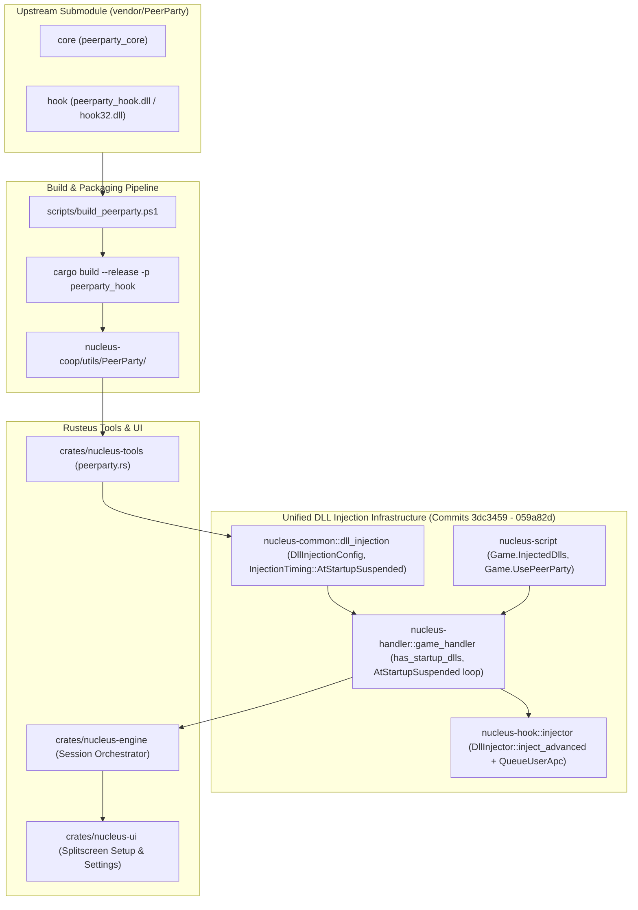

# PeerParty Integration into Rusteus — Architectural Design Specification

> **Date**: 2026-11-20  
> **Status**: Approved  
> **Subsystem**: `nucleus-tools`, `nucleus-hook`, `nucleus-script`, `nucleus-handler`, `nucleus-engine`, `nucleus-ui`  
> **Upstream**: [https://github.com/MaximumFreak/PeerParty.git](https://github.com/MaximumFreak/PeerParty.git) (v0.4.7)  
> **Unified Hooking Alignment**: Fully aligned with recent 6-Wave DLL Injection Infrastructure (commits `3dc3459` through `059a82d`)

---

## 1. Executive Summary & Problem Context

NucleusCoop (Rusteus) enables local splitscreen multiplayer on a single PC by running multiple game instances with sandboxed filesystem, input, and network isolation. To allow instances to discover and connect to each other, Rusteus has historically relied on external emulator DLLs:
- **Steamworks**: Goldberg Steam Emulator (replaces `steam_api.dll` / `steam_api64.dll`).
- **Epic Online Services (EOS)**: Nemirtingas Epic Emulator (replaces `EOSSDK-Win64-Shipping.dll`).
- **GOG Galaxy**: Nemirtingas Galaxy Emulator (replaces `Galaxy.dll` / `Galaxy64.dll`).

### Critical Limitations of the Legacy Emulators:
1. **Destructive File Replacement**: Legacy emulators physically overwrite or swap game DLLs in instance directories, breaking signed binaries, file checksums, and games with integrity self-checks.
2. **Unsupported Modern Middleware**: Goldberg and Nemirtingas do **not** support modern multiplayer middleware, including:
   - **Photon Networking** (Realtime, PUN, Bolt, Fusion over UDP/TCP/WS).
   - **Unity Gaming Services (UGS)** (Relay, Lobby with Wire events, Cloud Save, Vivox voice).
   - **PlayFab Party & Matchmaking** (C SDK, Xbox Live helpers, Web REST API).
   - **Demonware** (Activision matchmaking & server time).
3. **Local PC Isolation Only**: No built-in internet tunneling or BitTorrent DHT lobby sharing to link splitscreen sessions across distinct PCs without third-party VPN tools (ZeroTier / Hamachi).

### PeerParty Solution:
[PeerParty](https://github.com/MaximumFreak/PeerParty.git) is a pure-Rust, non-destructive multiplayer middleware emulation and P2P mesh layer. Instead of replacing DLLs on disk, it injects an in-memory hook (`peerparty_hook.dll`) that intercepts export lookups (`GetProcAddress`) and vtables, translating multiplayer primitives to a shared LAN core with BitTorrent DHT internet fallback, STUN NAT traversal, and encrypted ChaCha20-Poly1305 tunnels.

---

## 2. Integration Philosophy: Pipeline & Unified Injection Infrastructure

Per project directives, **PeerParty is NOT blindly copy-pasted into Rusteus**, nor does it introduce a parallel or duplicate injector. 

Instead, it plugs directly into the **recently landed 6-Wave DLL Injection Infrastructure** (commits `3dc3459` through `059a82d`):



### Direct Alignment with Recent Commits:

| Commit & Wave | Landed Infrastructure | How PeerParty Uses It Directly |
|---|---|---|
| **`3dc3459`** *(Wave 1: Models & Enums)* | `DllInjectionConfig`, `InjectionTiming::AtStartupSuspended`, `InjectionMethod`, `TargetArchitecture::Auto`, `TargetInstanceFilter` in `nucleus-common` | `nucleus-tools::peerparty` emits standard `DllInjectionConfig` instances with `timing: AtStartupSuspended`, `method: QueueUserApc` (or `CreateRemoteThread`), and `architecture: Auto`. Zero new configuration structs needed. |
| **`63c0720`** *(Wave 2: Hook Core & Injector)* | `PeInspector::verify_compatibility`, `RemoteMemoryGuard`, `DllInjector::inject_advanced` in `nucleus-hook` | Target game bitness detection (x64 vs WOW64) and safe remote memory loading use `PeInspector` and `DllInjector::inject_advanced` directly. We enhance `DllInjector` with `InjectionMethod::QueueUserApc` so all DLLs benefit from early-bird APC injection. |
| **`e387aea`** *(Wave 3: Named Pipe IPC & Memory)* | `NamedPipeIpcServer`, `SharedMemorySegment`, `MemoryEngine` in `nucleus-hook` | PeerParty’s overlay IPC or real-time lobby state exchange can communicate with Rusteus over the exact Named Pipe IPC channel established here. |
| **`87bd039`** *(Wave 4: Script Engine Bridge)* | `Game.InjectedDlls` declarative array, `Game.AddInjectedDll()`, dynamic `Context` injection APIs in `nucleus-script` | Handlers declaring `Game.UsePeerParty = true` automatically append PeerParty’s hook to `injected_dlls` under the hood. Handlers can also configure it directly via `Game.AddInjectedDll()`. |
| **`c95f63d`** *(Wave 5: Lifecycle & Staging)* | Multi-stage lifecycle triggers (`AtStartupSuspended`, `PostStartup`, `OnWindowCreated`) and `self.injected_modules` cleanup in `nucleus-handler` | In `game_handler.rs:1460-1505`, Rusteus **already** checks `has_startup_dlls`, spawns the process suspended via `start_process_extended(..., suspended = true)`, calls `DllInjector::inject_advanced`, tracks the module handle, and resumes the process. PeerParty gets early injection for free without modifying the process launch loop! |
| **`059a82d`** *(Wave 6: E2E Verification)* | `tests/e2e_dll_injection_suite.rs` end-to-end injection harness | PeerParty integration tests mirror this exact suite to verify module loading, architecture guards, and teardown cleanup. |

---

## 3. Detailed Component Architecture

### A. Submodule & Build Pipeline (`scripts/build_peerparty.ps1`)
- **Path**: `vendor/PeerParty` (Git submodule pinned to `v0.4.7`).
- **Output Artifacts**:
  - `nucleus-coop/utils/PeerParty/x64/peerparty_hook.dll`
  - `nucleus-coop/utils/PeerParty/x86/peerparty_hook32.dll`
  - `nucleus-coop/utils/PeerParty/peerparty.exe`
- **Build Targets**:
  - `x86_64-pc-windows-msvc` (for 64-bit games and launcher)
  - `i686-pc-windows-msvc` (for 32-bit WOW64 games)

### B. Rust Tool Driver (`crates/nucleus-tools/src/peerparty.rs`)
Manages configuration models and runtime environment injection:
```rust
#[derive(Debug, Clone, Serialize, Deserialize)]
pub struct PeerPartyConfig {
    pub enabled: bool,
    pub services: Vec<PeerPartyService>,
    pub room_code: Option<String>,
    pub public_sessions: bool,
    pub multi_instance: bool,
    pub copy_saves: bool,
    pub voice_enabled: bool,
    pub overlay_enabled: bool,
}

#[derive(Debug, Clone, Copy, PartialEq, Eq, Serialize, Deserialize)]
pub enum PeerPartyService {
    Steamworks,
    EpicOnlineServices,
    PlayFab,
    GogGalaxy,
    Photon,
    UnityGamingServices,
    Demonware,
    XboxLive,
}
```
**Responsibilities**:
- Resolves paths to `utils/PeerParty/x64/peerparty_hook.dll` or `utils/PeerParty/x86/peerparty_hook32.dll`.
- Creates a `DllInjectionConfig` configured with `timing = InjectionTiming::AtStartupSuspended` and `method = InjectionMethod::QueueUserApc`.
- Computes per-player environment variables:
  - `PEERPARTY_MULTI_INSTANCE=1`
  - `PEERPARTY_GAME_ROOT=<InstanceDir>`
  - `PEERPARTY_ROOM=<RoomCode>`
  - `PEERPARTY_SET=name=<PlayerNick>,voice=off,overlay=off`
  - `PEERPARTY_SERVICES=steam,eos,photon,ugs,playfab,demonware,galaxy`
- Coordinates with `nucleus-tools::users` for per-instance save isolation (`PEERPARTY_COPY_SAVES=1`).

### C. Unified Injector Enhancement: `QueueUserApc` in `nucleus-hook`
Rather than introducing a separate injector module, we add support for `InjectionMethod::QueueUserApc` directly into `DllInjector::inject_advanced` in `crates/nucleus-hook/src/injector.rs`:
- When target process is suspended and `config.method == InjectionMethod::QueueUserApc`:
  - `VirtualAllocEx` + `WriteProcessMemory` allocates and writes the wide DLL path (using `RemoteMemoryGuard`).
  - Enumerates the primary thread of the target suspended process via `CreateToolhelp32Snapshot(TH32CS_SNAPTHREAD)`.
  - Calls `QueueUserAPC(pfn_load_library, h_thread, remote_buf_addr)`.
  - When the process is resumed in `game_handler.rs:1504`, the APC executes before any game code or CRT entry point runs.

### D. JavaScript Handler Bridge (`crates/nucleus-script`)
Exposes PeerParty configuration to SplitscreenMe `.js` scripts:
```javascript
Game.UsePeerParty = true;
Game.PeerPartyServices = ["Steam", "Photon", "UGS"];
Game.PeerPartyRoom = ""; // Optional room code or prompted
Game.PeerPartyPublic = false;
Game.PeerPartyVoice = false;
```
When `Game.UsePeerParty = true` is evaluated:
1. `ScriptEngine` sets `handler.use_peerparty = true`.
2. Automatically generates and appends the `peerparty_hook.dll` entry into `Game.InjectedDlls`.
3. Populates `HandlerContext.peer_party_config` for consumption by `Game.Play`.

### E. Multi-Instance Staging & Process Launch (`crates/nucleus-handler`)
- In `prepare_instances()`:
  - Validates `peerparty_hook.dll` presence in `utils/PeerParty/`.
  - When `UsePeerParty` is active for a given service, suppresses conflicting legacy emulator deployment (e.g., Goldberg's `steam_api.dll` or Nemirtingas's `EOSSDK.dll`).
  - Staging configures `PEERPARTY_*` environment variables for each instance.
- In `launch_instance()`:
  - `game_handler.rs:1460-1505` detects `AtStartupSuspended` in `injected_dlls`.
  - Launches process suspended (`start_process_extended(..., suspended = true)`).
  - Calls `DllInjector::inject_advanced` which executes the APC / remote thread injection.
  - Adds the injected module to `self.injected_modules` for RAII cleanup.
  - Resumes the process.

### F. UI Integration (`crates/nucleus-ui`)
- **Splitscreen Setup View**:
  - Displays "Multiplayer Backend" dropdown when handler supports multiple providers (`Goldberg (Classic)` vs `PeerParty (Next-Gen)`).
  - Optional Room Code field for internet DHT co-op with remote friends.
- **Settings View**:
  - Global PeerParty settings: Default room code, Public Sessions toggle, In-game Voice Chat toggle.
